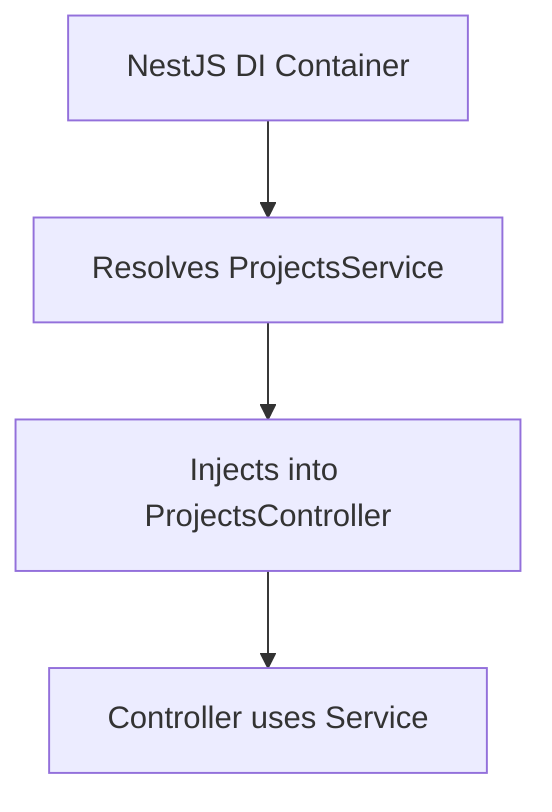
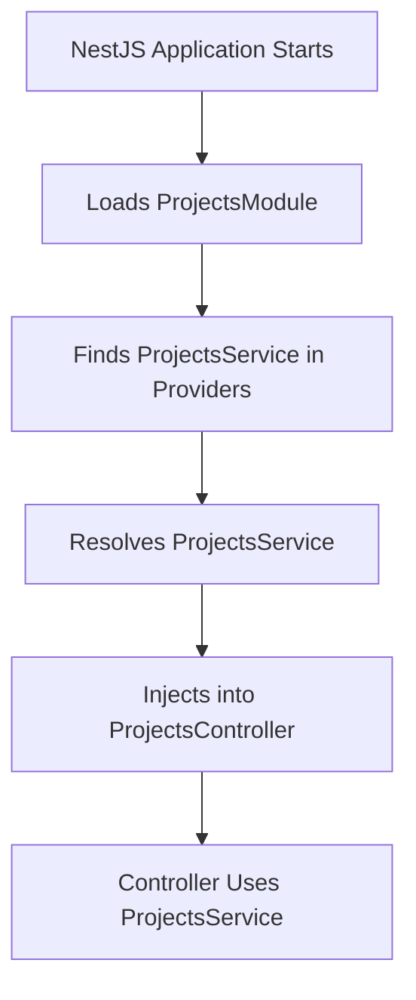

# NestJS – Modules, Controllers, Services & Dependency Injection

## Table of Contents

1. [Introduction to NestJS Architecture](#1-introduction-to-nestjs-architecture)
2. [Why NestJS Uses Modules, Controllers and Services](#2-why-nestjs-uses-modules-controllers-and-services)
3. [NestJS Architecture Overview](#3-nestjs-architecture-overview)
4. [Controllers](#4-controllers)
5. [Services](#5-services)
6. [Dependency Injection](#6-dependency-injection)
7. [Modules](#7-modules)
8. [Complete Project Implementation](#8-complete-project-implementation)
9. [How the Request Flow Works](#9-how-the-request-flow-works)
10. [Module Imports and Exports](#10-module-imports-and-exports)
11. [AppModule](#11-appmodule)
12. [NestJS CLI Commands](#12-nestjs-cli-commands)
13. [Project Structure](#13-project-structure)
14. [Controller vs Service vs Module](#14-controller-vs-service-vs-module)
15. [Common Mistakes](#15-common-mistakes)
16. [Interview Questions](#16-interview-questions)
17. [Interview-Ready Explanation](#17-interview-ready-explanation)
18. [Quick Revision](#18-quick-revision)

---

# 1. Introduction to NestJS Architecture

NestJS is a Node.js framework used to build scalable and maintainable backend applications.

NestJS uses TypeScript and provides a structured architecture based on several fundamental building blocks.

The three major building blocks are:

- Modules
- Controllers
- Services

These components help separate responsibilities within a backend application.

| Component | Responsibility |
|---|---|
| Module | Organizes related application components |
| Controller | Handles incoming HTTP requests |
| Service | Contains business logic |

---

# 2. Why NestJS Uses Modules, Controllers and Services

Imagine building a Project Management application.

The application needs to:

- Create projects.
- Fetch projects.
- Update projects.
- Delete projects.
- Manage clients.
- Manage users.
- Authenticate users.

If we put all the logic inside a single file, the application would become difficult to maintain.

Instead, NestJS separates responsibilities.

### Controller

Responsible for receiving requests and defining API endpoints.

### Service

Responsible for business logic and operations.

### Module

Responsible for organizing and connecting related components.

This separation makes the application:

- Maintainable
- Scalable
- Reusable
- Testable
- Organized

---

# 3. NestJS Architecture Overview

```text
                HTTP REQUEST
                     |
                     v
              ProjectsController
                     |
                     v
              ProjectsService
                     |
                     v
                  Database
                     |
                     v
              ProjectsService
                     |
                     v
              ProjectsController
                     |
                     v
                HTTP RESPONSE
```

Modules organize these components and manage their dependencies.

```text
                 ProjectsModule
                      |
          ┌───────────┴───────────┐
          |                       |
          v                       v
 ProjectsController         ProjectsService
```

---

# 4. Controllers

## What is a Controller?

A Controller is responsible for handling incoming HTTP requests and defining the routes through which clients interact with the backend application.

In simple words:

**A Controller is the entry point for HTTP requests.**

For example, when the frontend sends:

```http
GET /projects
```

The Controller receives the request and determines which method should execute.

## Creating a Controller

### projects.controller.ts

```typescript
import { Controller, Get } from '@nestjs/common';

@Controller('projects')
export class ProjectsController {

  @Get()
  getProjects() {
    return 'Getting all projects';
  }

}
```

### Understanding the Code

#### @Controller()

```typescript
@Controller('projects')
```

This defines the route prefix for the Controller.

All routes defined inside this Controller begin with:

```text
/projects
```

#### @Get()

```typescript
@Get()
```

This defines an HTTP GET route.

Combined with the Controller prefix, the endpoint becomes:

```http
GET /projects
```

#### getProjects()

```typescript
getProjects() {
  return 'Getting all projects';
}
```

This method executes when a request reaches the endpoint.

---

## Common Controller Decorators

| Decorator | Purpose |
|---|---|
| `@Controller()` | Defines a Controller |
| `@Get()` | Handles GET requests |
| `@Post()` | Handles POST requests |
| `@Put()` | Handles PUT requests |
| `@Patch()` | Handles PATCH requests |
| `@Delete()` | Handles DELETE requests |
| `@Param()` | Extracts route parameters |
| `@Query()` | Extracts query parameters |
| `@Body()` | Extracts request body |

## Example: CRUD Controller

```typescript
import {
  Controller,
  Get,
  Post,
  Put,
  Patch,
  Delete,
} from '@nestjs/common';

@Controller('projects')
export class ProjectsController {

  @Get()
  getAllProjects() {
    return 'Get all projects';
  }

  @Get(':id')
  getProjectById() {
    return 'Get project by ID';
  }

  @Post()
  createProject() {
    return 'Create project';
  }

  @Put(':id')
  updateProject() {
    return 'Replace project';
  }

  @Patch(':id')
  updateProjectPartially() {
    return 'Update project partially';
  }

  @Delete(':id')
  deleteProject() {
    return 'Delete project';
  }

}
```

### Endpoints

| Method | Endpoint | Purpose |
|---|---|---|
| GET | `/projects` | Get all projects |
| GET | `/projects/:id` | Get one project |
| POST | `/projects` | Create project |
| PUT | `/projects/:id` | Replace/update project |
| PATCH | `/projects/:id` | Partially update project |
| DELETE | `/projects/:id` | Delete project |

---

## Route Parameters

Route parameters are used to identify specific resources.

### Example

```typescript
@Get(':id')
getProjectById(@Param('id') id: string) {
  return `Project ID: ${id}`;
}
```

Request:

```http
GET /projects/10
```

Response:

```text
Project ID: 10
```

---

## Query Parameters

Query parameters are commonly used for filtering, searching and pagination.

### Example

```typescript
@Get()
getProjects(@Query('status') status: string) {
  return `Projects with status: ${status}`;
}
```

Request:

```http
GET /projects?status=active
```

---

## Request Body

The request body is commonly used when creating or updating resources.

```typescript
@Post()
createProject(@Body() project: any) {
  return project;
}
```

Example request:

```json
{
  "name": "Shree Cement",
  "status": "active"
}
```

---

# 5. Services

## What is a Service?

A Service is responsible for implementing business logic.

In simple words:

**A Service is where the actual work is performed.**

Services commonly handle:

- Database operations
- Business logic
- Data processing
- Calculations
- External API communication
- Reusable operations

Controllers generally delegate business logic to Services.

---

## Creating a Service

### projects.service.ts

```typescript
import { Injectable } from '@nestjs/common';

@Injectable()
export class ProjectsService {

  getAllProjects() {
    return [
      { id: 1, name: 'Shree Cement' },
      { id: 2, name: 'Electrolux' },
      { id: 3, name: 'TSS' },
    ];
  }

  getProjectById(id: number) {
    return {
      id,
      name: 'Sample Project',
    };
  }

  createProject(project: any) {
    return {
      message: 'Project created successfully',
      project,
    };
  }

}
```

## What is @Injectable()?

```typescript
@Injectable()
```

This decorator marks a class as a provider that can participate in NestJS Dependency Injection.

NestJS can create and manage instances of the class and inject them into other classes when required.

---

## Why Do We Need Services?

Without Services, we might put business logic directly inside the Controller.

```typescript
@Controller('projects')
export class ProjectsController {

  @Get()
  getProjects() {

    // Database logic

    // Business logic

    // Validation logic

    // Data processing

  }

}
```

This makes Controllers difficult to maintain as the application grows.

Instead:

```text
ProjectsController
       |
       v
ProjectsService
       |
       v
Database
```

The Controller handles the request.

The Service performs the operation.

---

# 6. Dependency Injection

## What is Dependency Injection?

Dependency Injection is a design pattern where a class receives the dependencies it needs instead of creating those dependencies itself.

NestJS provides a built-in Dependency Injection system.

### Without Dependency Injection

```typescript
export class ProjectsController {

  private projectsService = new ProjectsService();

}
```

The Controller manually creates the Service.

This tightly couples the Controller to the implementation.

### With Dependency Injection

```typescript
export class ProjectsController {

  constructor(
    private readonly projectsService: ProjectsService
  ) {}

}
```

NestJS manages the instance and injects it into the Controller.

---

## Understanding Constructor Injection

```typescript
constructor(
  private readonly projectsService: ProjectsService
) {}
```

This is constructor-based Dependency Injection.

NestJS sees that the Controller requires `ProjectsService`.

If the Service is registered as a provider in the module, NestJS can resolve and inject it.

### Benefits

- Loose coupling
- Reusability
- Easier testing
- Easier maintenance
- Centralized dependency management

---

# 7. Modules

## What is a Module?

A Module is used to organize and group related application components.

In simple words:

**A Module tells NestJS which Controllers and Providers belong together and how they are connected.**

For example:

- AuthModule
- UsersModule
- ProjectsModule
- ClientsModule
- NotificationsModule

Each module manages a specific feature or domain.

---

## Creating a Module

### projects.module.ts

```typescript
import { Module } from '@nestjs/common';

import { ProjectsController } from './projects.controller';

import { ProjectsService } from './projects.service';

@Module({

  controllers: [ProjectsController],

  providers: [ProjectsService],

})

export class ProjectsModule {}
```

---

## Understanding @Module()

The `@Module()` decorator accepts metadata.

### Controllers

```typescript
controllers: [ProjectsController]
```

Registers the Controllers belonging to the module.

### Providers

```typescript
providers: [ProjectsService]
```

Registers Services and other providers with NestJS Dependency Injection.

### Imports

```typescript
imports: []
```

Allows the module to access providers exported from other modules that it imports.

### Exports

```typescript
exports: [ProjectsService]
```

Makes selected providers available to other modules that import this module.

---

## Module Metadata

| Property | Purpose |
|---|---|
| `controllers` | Registers Controllers |
| `providers` | Registers Services and other providers |
| `imports` | Imports other Modules |
| `exports` | Exposes selected Providers |

---

# 8. Complete Project Implementation

Let's create a simple Projects feature using Modules, Controllers and Services.

## Folder Structure

```text
src/
│
├── projects/
│   ├── projects.controller.ts
│   ├── projects.service.ts
│   └── projects.module.ts
│
├── app.module.ts
│
└── main.ts
```

---

## Step 1: Create Projects Service

### projects.service.ts

```typescript
import { Injectable } from '@nestjs/common';

@Injectable()
export class ProjectsService {

  private projects = [
    { id: 1, name: 'Shree Cement' },
    { id: 2, name: 'Electrolux' },
  ];

  getAllProjects() {
    return this.projects;
  }

  getProjectById(id: number) {
    return this.projects.find(
      project => project.id === id
    );
  }

  createProject(project: any) {

    const newProject = {
      id: this.projects.length + 1,
      ...project,
    };

    this.projects.push(newProject);

    return newProject;
  }

}
```

The Service contains the logic for retrieving and creating projects.

This example uses an in-memory array instead of a database.

---

## Step 2: Create Projects Controller

### projects.controller.ts

```typescript
import {
  Controller,
  Get,
  Post,
  Param,
  Body,
} from '@nestjs/common';

import { ProjectsService } from './projects.service';

@Controller('projects')
export class ProjectsController {

  constructor(
    private readonly projectsService: ProjectsService
  ) {}

  @Get()
  getAllProjects() {
    return this.projectsService.getAllProjects();
  }

  @Get(':id')
  getProjectById(@Param('id') id: string) {
    return this.projectsService.getProjectById(Number(id));
  }

  @Post()
  createProject(@Body() project: any) {
    return this.projectsService.createProject(project);
  }

}
```

The Controller receives HTTP requests and delegates operations to ProjectsService.

---

## Step 3: Create Projects Module

### projects.module.ts

```typescript
import { Module } from '@nestjs/common';

import { ProjectsController } from './projects.controller';

import { ProjectsService } from './projects.service';

@Module({

  controllers: [ProjectsController],

  providers: [ProjectsService],

})

export class ProjectsModule {}
```

The Module registers the Controller and Service.

---

## Step 4: Create App Module

### app.module.ts

```typescript
import { Module } from '@nestjs/common';

import { ProjectsModule } from './projects/projects.module';

@Module({

  imports: [ProjectsModule],

})

export class AppModule {}
```

The AppModule imports ProjectsModule.

---

# 9. How the Request Flow Works

Suppose the frontend sends:

```http
GET http://localhost:3000/projects
```

### Step 1: Frontend sends request

```http
GET /projects
```

### Step 2: Controller receives request

NestJS identifies:

```typescript
@Controller('projects')
```

and:

```typescript
@Get()
```

### Step 3: Controller calls Service

```typescript
return this.projectsService.getAllProjects();
```

### Step 4: Service executes business logic

```typescript
getAllProjects() {
  return this.projects;
}
```

The Service returns the data.

### Step 5: Controller returns the response

NestJS serializes the returned data into an HTTP response, generally JSON.

### Complete Flow

```text
Frontend
   |
   | GET /projects
   v
ProjectsController
   |
   | getAllProjects()
   v
ProjectsService
   |
   | Retrieves Data
   v
Database / Data Source
   |
   v
ProjectsService
   |
   v
ProjectsController
   |
   v
HTTP Response
```

---

# 10. Module Imports and Exports

Modules can share Providers with other modules.

Suppose ProjectsModule needs UsersService.

UsersService belongs to UsersModule.

We need to:

1. Register UsersService in UsersModule.
2. Export UsersService from UsersModule.
3. Import UsersModule into ProjectsModule.
4. Inject UsersService into ProjectsService.

---

## Step 1: Create Users Module

### users.module.ts

```typescript
import { Module } from '@nestjs/common';

import { UsersController } from './users.controller';

import { UsersService } from './users.service';

@Module({

  controllers: [UsersController],

  providers: [UsersService],

  exports: [UsersService],

})

export class UsersModule {}
```

The `exports` property makes UsersService available to importing modules.

---

## Step 2: Import UsersModule into ProjectsModule

### projects.module.ts

```typescript
import { Module } from '@nestjs/common';

import { ProjectsController } from './projects.controller';

import { ProjectsService } from './projects.service';

import { UsersModule } from '../users/users.module';

@Module({

  imports: [UsersModule],

  controllers: [ProjectsController],

  providers: [ProjectsService],

})

export class ProjectsModule {}
```

---

## Step 3: Inject UsersService into ProjectsService

### projects.service.ts

```typescript
import { Injectable } from '@nestjs/common';

import { UsersService } from '../users/users.service';

@Injectable()
export class ProjectsService {

  constructor(
    private readonly usersService: UsersService
  ) {}

  getProjectsByUser(userId: number) {

    const user = this.usersService.findUserById(userId);

    return {
      user,
      projects: [],
    };

  }

}
```

Now ProjectsService can use UsersService because UsersModule exports it and ProjectsModule imports UsersModule.

---

## Module Communication

```text
                UsersModule
                    |
                    |
              exports UsersService
                    |
                    v
               ProjectsModule
                    |
                    v
             ProjectsService
                    |
                    v
               UsersService
```

---

# 11. AppModule

AppModule is generally the root module of a NestJS application.

It imports the feature modules required by the application.

### app.module.ts

```typescript
import { Module } from '@nestjs/common';

import { AuthModule } from './auth/auth.module';

import { UsersModule } from './users/users.module';

import { ProjectsModule } from './projects/projects.module';

import { ClientsModule } from './clients/clients.module';

import { NotificationsModule } from './notifications/notifications.module';

@Module({

  imports: [
    AuthModule,
    UsersModule,
    ProjectsModule,
    ClientsModule,
    NotificationsModule,
  ],

})

export class AppModule {}
```

### AppModule Responsibilities

- Acts as the root module.
- Imports feature modules.
- Helps NestJS assemble the application dependency graph.

---

# 12. NestJS CLI Commands

NestJS CLI can automatically generate modules, controllers and services.

## Generate Module

```bash
nest g module projects
```

## Generate Controller

```bash
nest g controller projects
```

## Generate Service

```bash
nest g service projects
```

## Generate Complete CRUD Resource

```bash
nest g resource projects
```

The resource command generates a feature structure and scaffolding for common CRUD operations.

---

# 13. Project Structure

A scalable NestJS application may follow this structure:

```text
src/
│
├── app.module.ts
│
├── auth/
│   ├── auth.controller.ts
│   ├── auth.service.ts
│   └── auth.module.ts
│
├── users/
│   ├── users.controller.ts
│   ├── users.service.ts
│   └── users.module.ts
│
├── projects/
│   ├── projects.controller.ts
│   ├── projects.service.ts
│   └── projects.module.ts
│
├── clients/
│   ├── clients.controller.ts
│   ├── clients.service.ts
│   └── clients.module.ts
│
└── notifications/
    ├── notifications.controller.ts
    ├── notifications.service.ts
    └── notifications.module.ts
```

### Feature-Based Architecture

Each feature is organized into its own folder.

For example:

- Authentication
- Users
- Projects
- Clients
- Notifications

This makes the application easier to maintain and extend.

---

# 14. Controller vs Service vs Module

| Feature | Controller | Service | Module |
|---|---|---|---|
| Purpose | Handle requests | Business logic | Organize components |
| HTTP routes | Yes | No | No |
| HTTP request handling | Yes | No | No |
| Business logic | Ideally minimal | Yes | No |
| Database interaction | Usually delegates | Commonly | No |
| Decorator | `@Controller()` | `@Injectable()` | `@Module()` |
| DI role | Receives dependencies | Receives dependencies | Registers dependencies |
| Example | ProjectsController | ProjectsService | ProjectsModule |

---

# 15. Common Mistakes

## Mistake 1: Putting Everything in Controller

Controllers should generally remain focused on request handling.

Business logic should be delegated to Services or other appropriate providers.

---

## Mistake 2: Forgetting to Register Service

Incorrect:

```typescript
@Module({

  controllers: [ProjectsController],

})
export class ProjectsModule {}
```

If ProjectsController injects ProjectsService, ProjectsService must be registered or otherwise available through the module dependency graph.

Correct:

```typescript
@Module({

  controllers: [ProjectsController],

  providers: [ProjectsService],

})
export class ProjectsModule {}
```

---

## Mistake 3: Forgetting to Export a Service

If another module needs a Service, the owning module must export it, and the consuming module must import the owning module.

---

## Mistake 4: Manually Instantiating Services

Avoid:

```typescript
const service = new ProjectsService();
```

In NestJS, use Dependency Injection so the framework can manage the provider.

---

## Mistake 5: Confusing Modules and Services

A Module organizes and registers components.

A Service performs operations.

A Controller handles incoming requests.

---

# 16. Interview Questions

## Q1. What is a Controller in NestJS?

A Controller handles incoming HTTP requests, defines routes and delegates business logic to Services.

---

## Q2. What is a Service in NestJS?

A Service is a provider that generally contains business logic and performs operations such as database queries, calculations or external API interactions.

---

## Q3. What is a Module in NestJS?

A Module organizes related Controllers and Providers and manages dependencies through imports, exports and registrations.

---

## Q4. What is Dependency Injection?

Dependency Injection is a design pattern in which a class receives dependencies from an external system rather than creating them itself.

NestJS provides a built-in DI container.

---

## Q5. What is @Injectable()?

`@Injectable()` marks a class as a provider that can participate in NestJS Dependency Injection.

---

## Q6. What is @Controller()?

`@Controller()` defines a Controller and optionally its route prefix.

---

## Q7. What is @Module()?

`@Module()` defines module metadata such as Controllers, Providers, Imports and Exports.

---

## Q8. What is the purpose of providers?

Providers are classes or other injectable values that NestJS can manage and inject into other components.

Services are commonly registered as providers.

---

## Q9. What is the purpose of imports in a Module?

Imports allow a module to access providers exported from other modules.

---

## Q10. What is the purpose of exports in a Module?

Exports make selected providers available to other modules that import the module.

---

## Q11. How does a Controller communicate with a Service?

A Controller receives the Service through Dependency Injection, typically using constructor injection, and calls its methods.

---

## Q12. Why do we separate Controller and Service?

This separation keeps request handling separate from business logic, making applications more maintainable, reusable and testable.

---

## Q13. What is AppModule?

AppModule is generally the root module that imports the application's feature modules.

---

## Q14. What is constructor injection?

Constructor injection is a technique where dependencies are supplied through a class constructor.

---

## Q15. Can one Module use another Module's Service?

Yes. The module owning the Service exports it, and the consuming module imports that module.

---

# 17. Interview-Ready Explanation

If an interviewer asks:

**"Explain Modules, Controllers and Services in NestJS."**

You can answer:

NestJS follows a modular architecture in which Modules, Controllers and Services are the fundamental building blocks.

A Controller is responsible for handling incoming HTTP requests. We define API routes using decorators such as `@Get()`, `@Post()`, `@Put()` and `@Delete()`. The Controller receives the request, extracts the required data and delegates the business logic to a Service.

A Service is responsible for implementing business logic. We generally use Services for database operations, business rules, calculations, data processing and communication with other services. Services are decorated with `@Injectable()` so that NestJS can manage them through Dependency Injection.

A Module is used to organize related Controllers and Providers. Using the `@Module()` decorator, we register Controllers and Providers, import other modules when required and export providers that other modules need to access.

NestJS also provides Dependency Injection, which allows us to inject Services into Controllers or other Services instead of manually creating instances.

This separation of responsibilities makes the application modular, scalable, reusable and easier to maintain.

---

# 18. Quick Revision

| Concept | Meaning |
|---|---|
| NestJS | Node.js backend framework |
| Controller | Handles HTTP requests |
| Service | Contains business logic |
| Module | Organizes components |
| `@Controller()` | Defines a Controller |
| `@Injectable()` | Marks a class as injectable |
| `@Module()` | Defines module metadata |
| `@Get()` | Handles GET requests |
| `@Post()` | Handles POST requests |
| `@Param()` | Extracts route parameters |
| `@Query()` | Extracts query parameters |
| `@Body()` | Extracts request body |
| Dependency Injection | Provides dependencies to classes |
| Providers | Injectable components managed by NestJS |
| Imports | Imports other modules |
| Exports | Exposes providers to other modules |
| AppModule | Root module |

---

# Final Summary

```text
MODULE
   |
   |-- Organizes
   |
   |-- Controller
   |      |
   |      |-- Receives HTTP Request
   |      |
   |      |-- Calls Service
   |
   |-- Service
          |
          |-- Business Logic
          |
          |-- Database Operations
          |
          |-- External API Operations
```

### Remember

- **Module = Organizer**
- **Controller = Request Handler**
- **Service = Business Logic**
- **Dependency Injection = Dependencies provided by NestJS**

Understanding these four concepts is the foundation of building backend applications using NestJS.


# Dependency Injection (DI) and Access Modifiers in NestJS

## 1. What is Dependency Injection (DI)?

Dependency Injection (DI) is a design pattern in which a class receives the objects or dependencies it needs from another system instead of creating those objects itself.

In NestJS, the Dependency Injection system manages the creation and delivery of dependencies to the classes that need them.

### Simple Example

Imagine a ProjectsController needs a ProjectsService to fetch project data.

Without Dependency Injection, the Controller creates the Service itself.

With Dependency Injection, NestJS creates or resolves the Service and provides it to the Controller.

### Basic Flow



---

## 2. What is a Dependency?

A dependency is an object or class that another class requires to perform its work.

For example:

```typescript
export class ProjectsService {
  getProjects() {
    return ['Project A', 'Project B'];
  }
}
```

The ProjectsController needs ProjectsService to retrieve project data.

Therefore, ProjectsService is a dependency of ProjectsController.

---

## 3. Without Dependency Injection

In this approach, the Controller creates the Service by itself using the `new` keyword.

### projects.service.ts

```typescript
export class ProjectsService {
  getProjects() {
    return ['Project A', 'Project B'];
  }
}
```

### projects.controller.ts

```typescript
export class ProjectsController {
  private projectsService = new ProjectsService();

  getProjects() {
    return this.projectsService.getProjects();
  }
}
```

### What is happening?

```typescript
private projectsService = new ProjectsService();
```

- `ProjectsService` is a class.
- `new ProjectsService()` creates an instance of that class.
- The created instance is assigned to the `projectsService` property.
- The Controller is responsible for creating its own dependency.

### Problems with this approach

- The Controller is tightly coupled to ProjectsService.
- The Controller decides how its dependency is created.
- Replacing the dependency can require modifying the Controller.
- Testing and mocking dependencies can become more difficult.

---

## 4. What is Dependency Injection in NestJS?

Instead of creating the dependency manually, we allow NestJS to manage and provide it.

### Step 1: Create the Service

#### projects.service.ts

```typescript
import { Injectable } from '@nestjs/common';

@Injectable()
export class ProjectsService {
  getProjects() {
    return ['Project A', 'Project B'];
  }
}
```

### What is `@Injectable()`?

`@Injectable()` is a decorator that marks a class as available for NestJS's dependency injection system.

It allows NestJS to use the class as a provider and resolve its dependencies.

---

### Step 2: Register the Service in the Module

#### projects.module.ts

```typescript
import { Module } from '@nestjs/common';
import { ProjectsController } from './projects.controller';
import { ProjectsService } from './projects.service';

@Module({
  controllers: [ProjectsController],
  providers: [ProjectsService],
})
export class ProjectsModule {}
```

### What is `providers`?

The `providers` array tells NestJS which providers are available in the module's dependency injection context.

```typescript
providers: [ProjectsService]
```

Here, we are registering ProjectsService so NestJS can manage and provide it.

---

### Step 3: Inject the Service into the Controller

#### projects.controller.ts

```typescript
import { Controller, Get } from '@nestjs/common';
import { ProjectsService } from './projects.service';

@Controller('projects')
export class ProjectsController {
  constructor(
    private readonly projectsService: ProjectsService,
  ) {}

  @Get()
  getProjects() {
    return this.projectsService.getProjects();
  }
}
```

### What is happening here?

```typescript
constructor(
  private readonly projectsService: ProjectsService,
) {}
```

- `constructor` is the constructor of the class.
- `projectsService` is the dependency that the Controller needs.
- `ProjectsService` specifies the dependency's type.
- NestJS resolves and provides the dependency.
- `private` restricts access to the property.
- `readonly` prevents reassignment of the property.

The Controller does not manually create the ProjectsService instance.

NestJS manages the dependency.

---

## 5. How Does NestJS Dependency Injection Work?

When the NestJS application starts, the DI system roughly follows this process:

1. NestJS loads the module.
2. It checks the providers registered in the module.
3. It identifies the dependencies required by the Controller.
4. It resolves and creates or reuses the required provider instances according to their scope.
5. It injects the dependency into the Controller.
6. The Controller can use the injected Service.

### Flow Diagram



---

## 6. Understanding `new` vs Dependency Injection

### Without DI

```typescript
export class ProjectsController {
  private projectsService = new ProjectsService();
}
```

Here, the Controller creates the dependency itself.

### With DI

```typescript
export class ProjectsController {
  constructor(
    private readonly projectsService: ProjectsService,
  ) {}
}
```

Here, the Controller declares the dependency it needs, and NestJS provides it.

| Without DI | With DI |
|---|---|
| Uses `new ProjectsService()` | Uses constructor injection |
| Controller creates the dependency | NestJS resolves the dependency |
| Controller manages creation | DI container manages creation |
| More tightly coupled | Easier to replace and mock dependencies |

---

# 7. TypeScript Access Modifiers

Access modifiers control where class properties and methods can be accessed.

TypeScript provides three commonly used access modifiers:

- `public`
- `private`
- `protected`

---

## 8. Public

`public` allows a property or method to be accessed from anywhere.

In TypeScript, class members are public by default when no access modifier is specified.

### Example

```typescript
class ProjectsService {
  public projectName = 'Project A';

  getProjectName() {
    return this.projectName;
  }
}
```

### Accessing from outside the class

```typescript
const service = new ProjectsService();

console.log(service.projectName);
```

This is allowed because `projectName` is public.

### Public in Constructor Injection

```typescript
constructor(
  public readonly projectsService: ProjectsService,
) {}
```

The projectsService property can be accessed from outside the class.

---

## 9. Private

`private` restricts direct access to a property or method to the class in which it is declared.

### Example

```typescript
class ProjectsService {
  private projectName = 'Project A';

  getProjectName() {
    return this.projectName;
  }
}
```

### Access inside the class

```typescript
getProjectName() {
  return this.projectName;
}
```

This is allowed.

### Access outside the class

```typescript
const service = new ProjectsService();

// TypeScript error
console.log(service.projectName);
```

This is not allowed because projectName is private.

### Private in Constructor Injection

```typescript
constructor(
  private readonly projectsService: ProjectsService,
) {}
```

The Controller can access the projectsService property internally.

But other code cannot directly access the property through a ProjectsController instance.

---

## 10. Protected

`protected` allows a property or method to be accessed:

- Inside the class where it is declared.
- Inside classes that inherit from that class.

It does not allow direct access from unrelated outside code.

### Example

```typescript
class BaseController {
  protected projectName = 'Project A';
}

class ProjectsController extends BaseController {
  getProjectName() {
    return this.projectName;
  }
}
```

The ProjectsController can access projectName because it inherits from BaseController.

### Outside Access

```typescript
const controller = new BaseController();

// TypeScript error
console.log(controller.projectName);
```

This is not allowed because projectName is protected.

### Protected in Constructor Injection

```typescript
constructor(
  protected readonly projectsService: ProjectsService,
) {}
```

This allows the current class and its subclasses to access the dependency.

---

## 11. Comparison of Access Modifiers

| Modifier | Same Class | Subclass | Outside Class |
|---|---|---|---|
| `public` | Yes | Yes | Yes |
| `protected` | Yes | Yes | No |
| `private` | Yes | No | No |

---

# 12. What is `readonly`?

`readonly` is a TypeScript modifier that prevents a property from being reassigned after its initialization or constructor assignment.

It does not prevent calling methods on the object.

### Example

```typescript
class ProjectsController {
  readonly projectName = 'Project A';
}
```

### Allowed

```typescript
console.log(controller.projectName);
```

### Not Allowed

```typescript
controller.projectName = 'Project B';
```

TypeScript reports an error because projectName is readonly.

---

## 13. readonly Does Not Mean the Object Is Immutable

Consider the following:

```typescript
class DatabaseService {
  connectionStatus = 'Disconnected';

  connect() {
    this.connectionStatus = 'Connected';
  }
}
```

Now:

```typescript
class ProjectsService {
  constructor(
    private readonly databaseService: DatabaseService,
  ) {}
}
```

The following is not allowed:

```typescript
this.databaseService = anotherDatabaseService;
```

But this is allowed:

```typescript
this.databaseService.connect();
```

And the DatabaseService can update its own internal properties.

### Why?

`readonly` prevents reassignment of the property reference.

It does not make the object itself immutable.

---

# 14. Why Do We Use `private readonly` in NestJS?

A common NestJS pattern is:

```typescript
constructor(
  private readonly projectsService: ProjectsService,
) {}
```

### `private`

The dependency is an internal property of the class.

Other unrelated classes cannot directly access it through the Controller instance.

### `readonly`

The dependency reference should not accidentally be reassigned.

### `ProjectsService`

It tells TypeScript and NestJS which dependency is expected.

### Constructor Injection

NestJS resolves and provides the dependency.

---

# 15. Understanding `private readonly` Together

```typescript
constructor(
  private readonly projectsService: ProjectsService,
) {}
```

This means:

- Create a property named `projectsService`.
- Its type is ProjectsService.
- Allow access only inside this class.
- Prevent reassignment of this property.
- Receive the dependency through the constructor.

---

# 16. What is Constructor Parameter Property Shorthand?

This code:

```typescript
constructor(
  private readonly projectsService: ProjectsService,
) {}
```

is a TypeScript feature called a parameter property.

It automatically declares a class property and assigns the constructor parameter to that property.

It is approximately equivalent to:

```typescript
export class ProjectsController {
  private readonly projectsService: ProjectsService;

  constructor(projectsService: ProjectsService) {
    this.projectsService = projectsService;
  }
}
```

Instead of writing both the property declaration and assignment, TypeScript allows us to use the shorter syntax.

---

# 17. Different Combinations

We can combine access modifiers with readonly.

| Syntax | Meaning |
|---|---|
| `public projectsService` | Accessible everywhere |
| `private projectsService` | Accessible only inside the class |
| `protected projectsService` | Accessible inside the class and subclasses |
| `public readonly projectsService` | Accessible everywhere, but cannot be reassigned |
| `private readonly projectsService` | Accessible only inside the class, but cannot be reassigned |
| `protected readonly projectsService` | Accessible inside the class and subclasses, but cannot be reassigned |

---

# 18. Complete NestJS Example

### projects.service.ts

```typescript
import { Injectable } from '@nestjs/common';

@Injectable()
export class ProjectsService {
  getProjects() {
    return [
      'Shree Cement',
      'Electrolux',
      'TSS',
    ];
  }
}
```

### projects.module.ts

```typescript
import { Module } from '@nestjs/common';
import { ProjectsController } from './projects.controller';
import { ProjectsService } from './projects.service';

@Module({
  controllers: [ProjectsController],
  providers: [ProjectsService],
})
export class ProjectsModule {}
```

### projects.controller.ts

```typescript
import { Controller, Get } from '@nestjs/common';
import { ProjectsService } from './projects.service';

@Controller('projects')
export class ProjectsController {
  constructor(
    private readonly projectsService: ProjectsService,
  ) {}

  @Get()
  getProjects() {
    return this.projectsService.getProjects();
  }
}
```

### API Request

```http
GET /projects
```

### Response

```json
[
  "Shree Cement",
  "Electrolux",
  "TSS"
]
```

---

# 19. Benefits of Dependency Injection

- **Loose coupling:** Classes don't need to manage the creation of their dependencies.
- **Reusability:** Providers can be reused by multiple components.
- **Testability:** Dependencies can be replaced with mock implementations.
- **Maintainability:** Dependency creation and configuration are managed centrally.
- **Scalability:** Managing dependencies becomes easier as the application grows.

---

# 20. Interview Questions

### Q1. What is Dependency Injection?

Dependency Injection is a design pattern in which a class receives its dependencies from an external system rather than creating them itself.

In NestJS, the DI container manages and provides dependencies.

### Q2. Why do we use Dependency Injection in NestJS?

We use DI to reduce coupling, improve reusability, simplify testing, and manage dependencies centrally.

### Q3. What is `@Injectable()`?

`@Injectable()` marks a class as available for NestJS's dependency injection system, allowing it to be registered and used as a provider.

### Q4. What is the role of `providers` in a Module?

The providers array registers classes and other provider definitions that NestJS can manage and resolve within the module's dependency injection context.

### Q5. What is constructor injection?

Constructor injection is a technique in which dependencies are provided to a class through its constructor.

### Q6. What is the difference between `private` and `protected`?

Private members are accessible only inside the declaring class.

Protected members are accessible inside the declaring class and its subclasses.

### Q7. What is the difference between `public` and `private`?

Public members can be accessed from anywhere.

Private members can only be accessed directly within the declaring class.

### Q8. What does `readonly` do?

Readonly prevents a property from being reassigned after initialization or constructor assignment.

### Q9. Does `readonly` make an object immutable?

No. It prevents reassignment of the property reference, not modification of the object's internal state.

### Q10. Why do we use `private readonly` in NestJS?

It restricts access to the injected property within the class and prevents reassignment of the dependency reference.

### Q11. Does changing `private` to `public` affect Dependency Injection?

No. Access modifiers control access to the property, not the DI mechanism.

### Q12. Does NestJS create a new Service instance for every request?

Not necessarily. By default, NestJS providers generally use singleton scope, meaning the same provider instance is shared within its module/application context. Request-scoped and transient providers behave differently.

---

# 21. Interview-Ready Explanation

Dependency Injection is a design pattern used to reduce coupling between classes.

In NestJS, when a Controller needs a Service, instead of creating that Service manually using the `new` keyword, we register the Service as a provider inside the Module and inject it through the Controller's constructor.

NestJS's DI container resolves and provides the required instance.

We commonly use `private readonly` in constructor injection. `private` restricts direct access to the property outside the class, while `readonly` prevents reassignment of the dependency reference.

This makes our code more maintainable, reusable and testable.

---

# 22. Quick Revision

| Concept | Meaning |
|---|---|
| Dependency | An object or class another class needs |
| DI | Providing dependencies instead of manually creating them |
| `@Injectable()` | Marks a class for NestJS's provider system |
| `providers` | Registers providers within a module |
| Constructor injection | Receives dependencies through the constructor |
| `new Service()` | Manually creates a Service instance |
| `private` | Restricts direct access to the class |
| `protected` | Restricts access to the class and subclasses |
| `public` | Allows access from anywhere |
| `readonly` | Prevents property reassignment |
| `private readonly` | Internal property that cannot be reassigned |
| DI Container | NestJS system that resolves and provides dependencies |

---

## The Most Important Concept

Without DI:

```typescript
private projectsService = new ProjectsService();
```

The Controller creates its own dependency.

With DI:

```typescript
constructor(
  private readonly projectsService: ProjectsService,
) {}
```

The Controller requests the dependency, and NestJS provides it.


# NestJS Backend Fundamentals: DTOs, Pipes, Entities & TypeORM

This README covers some of the fundamental concepts used while building backend applications using NestJS, TypeScript and PostgreSQL.

## Table of Contents

1. [Providers in NestJS](#1-providers-in-nestjs)
2. [DTO (Data Transfer Object)](#2-dto-data-transfer-object)
3. [Why DTO Alone Does Not Validate](#3-why-dto-alone-does-not-validate)
4. [Pipes in NestJS](#4-pipes-in-nestjs)
5. [ValidationPipe](#5-validationpipe)
6. [Built-in Pipes](#6-built-in-pipes)
7. [Entity in TypeORM](#7-entity-in-typeorm)
8. [Components of an Entity](#8-components-of-an-entity)
9. [What is TypeORM?](#9-what-is-typeorm)
10. [Working Without TypeORM](#10-working-without-typeorm)
11. [Working With TypeORM](#11-working-with-typeorm)
12. [TypeORM Repository](#12-typeorm-repository)
13. [CRUD Operations Without TypeORM](#13-crud-operations-without-typeorm)
14. [CRUD Operations With TypeORM](#14-crud-operations-with-typeorm)
15. [DTO vs Entity](#15-dto-vs-entity)
16. [TypeORM Synchronization and Migrations](#16-typeorm-synchronization-and-migrations)
17. [Complete Request Flow](#17-complete-request-flow)
18. [Interview Questions](#18-interview-questions)
19. [Quick Revision](#19-quick-revision)

---

# 1. Providers in NestJS

## What is a Provider?

A Provider is a class that NestJS can manage through its Dependency Injection system.

Providers are commonly used to implement:

- Business logic
- Database operations
- Services
- Repositories
- Helper functionality

A Service is the most common type of Provider.

### Example: ProjectsService

```typescript
import { Injectable } from '@nestjs/common';

@Injectable()
export class ProjectsService {
  getProjects() {
    return ['Project A', 'Project B', 'Project C'];
  }
}
```

### Understanding the code

- `@Injectable()` marks the class as available to NestJS's dependency injection system.
- `ProjectsService` contains the business logic.
- `getProjects()` is a method that returns project data.

## Registering the Provider

Providers must be registered inside the module.

```typescript
import { Module } from '@nestjs/common';
import { ProjectsService } from './projects.service';
import { ProjectsController } from './projects.controller';

@Module({
  controllers: [ProjectsController],
  providers: [ProjectsService],
})
export class ProjectsModule {}
```

### Why do we register a Service inside `providers`?

By registering the service, we tell NestJS to manage its instantiation and dependency resolution within the module context.

## Injecting the Provider into a Controller

```typescript
import { Controller, Get } from '@nestjs/common';
import { ProjectsService } from './projects.service';

@Controller('projects')
export class ProjectsController {
  constructor(private readonly projectsService: ProjectsService) {}

  @Get()
  getProjects() {
    return this.projectsService.getProjects();
  }
}
```

Instead of manually creating the service:

```typescript
const projectsService = new ProjectsService();
```

NestJS injects the required instance through the constructor.

### Benefits of Providers

- Separation of concerns
- Reusability
- Dependency Injection
- Easier testing
- Better maintainability
- Reduced coupling

---

# 2. DTO (Data Transfer Object)

## What is a DTO?

DTO stands for Data Transfer Object.

A DTO defines the expected structure of data that is transferred between parts of an application, commonly between the frontend and backend.

DTOs are commonly used to define the structure of:

- Request bodies
- API input data
- Data passed between application layers
- API response models (when designed for that purpose)

### Example: CreateUserDto

```typescript
export class CreateUserDto {
  id: number;
  name: string;
}
```

This DTO defines:

- `id` should be a number.
- `name` should be a string.

However, TypeScript types alone do not validate incoming HTTP data at runtime.

---

# 3. Why DTO Alone Does Not Validate

Consider the following DTO:

```typescript
export class CreateUserDto {
  id: number;
  name: string;
}
```

Suppose the frontend sends the following requests.

### Request 1

```json
{
  "id": 1,
  "name": "Samir"
}
```

### Request 2

```json
{
  "id": 1,
  "name": 344
}
```

### Request 3

```json
{
  "id": 1,
  "name": "West Timer"
}
```

Without runtime validation, all three requests can reach the controller.

| Request | Result without runtime validation |
|---|---|
| `1, "Samir"` | Can pass |
| `1, 344` | Can pass |
| `1, "West Timer"` | Can pass |

### Why?

TypeScript types are removed during compilation.

For example:

```typescript
name: string;
```

is a TypeScript declaration. It does not automatically enforce that incoming JSON must contain a string at runtime.

To perform runtime validation, we need validation decorators and a Pipe.

---

# 4. Pipes in NestJS

## What is a Pipe?

A Pipe is a mechanism that processes incoming data before it reaches the controller handler.

Pipes are commonly used for:

1. Validation
2. Transformation

### Validation

Validation checks whether the incoming data satisfies the required rules.

Example:

- Is the name a string?
- Is the email valid?
- Is the ID an integer?
- Is the password long enough?

### Transformation

Transformation converts incoming data into a different format or type.

Example:

- Convert a string `"10"` into the number `10`.
- Convert incoming data into a specific object structure.

### Request flow

```text
Frontend Request
      |
      v
     Pipe
      |
      |-- Validation
      |
      |-- Transformation
      |
      v
  Controller
      |
      v
   Service
```

---

# 5. ValidationPipe

ValidationPipe is a built-in NestJS Pipe that performs runtime validation using validation decorators.

To use it, we commonly use:

- `class-validator`
- `class-transformer`

## Installation

```bash
npm install class-validator class-transformer
```

## Step 1: Create a DTO with validation decorators

### create-user.dto.ts

```typescript
import { IsInt, IsString } from 'class-validator';

export class CreateUserDto {
  @IsInt()
  id: number;

  @IsString()
  name: string;
}
```

### Understanding the decorators

| Decorator | Purpose |
|---|---|
| `@IsInt()` | Ensures the value is an integer |
| `@IsString()` | Ensures the value is a string |

Now we have defined runtime validation rules.

## Step 2: Enable ValidationPipe globally

### main.ts

```typescript
import { NestFactory } from '@nestjs/core';
import { AppModule } from './app.module';
import { ValidationPipe } from '@nestjs/common';

async function bootstrap() {
  const app = await NestFactory.create(AppModule);

  app.useGlobalPipes(
    new ValidationPipe(),
  );

  await app.listen(3000);
}

bootstrap();
```

Now NestJS will validate incoming data against the applicable DTO validation decorators.

## Step 3: Understanding validation

### Valid request

```json
{
  "id": 1,
  "name": "Samir"
}
```

The request passes validation.

### Invalid request

```json
{
  "id": 1,
  "name": 344
}
```

The request fails because `name` is expected to be a string.

NestJS returns a `400 Bad Request` response by default when validation fails.

The controller handler will not execute for that request.

---

# 6. Built-in Pipes

NestJS provides several built-in Pipes.

| Pipe | Purpose |
|---|---|
| `ValidationPipe` | Validates incoming data against DTO validation rules |
| `ParseIntPipe` | Converts and validates integer input |
| `ParseBoolPipe` | Converts and validates boolean input |
| `ParseUUIDPipe` | Validates UUID values |
| `ParseArrayPipe` | Parses and validates arrays |
| `DefaultValuePipe` | Provides a default value when input is absent |

## Example: ParseIntPipe

```typescript
import {
  Controller,
  Get,
  Param,
  ParseIntPipe,
} from '@nestjs/common';

@Controller('projects')
export class ProjectsController {

  @Get(':id')
  getProject(@Param('id', ParseIntPipe) id: number) {
    return id;
  }
}
```

### Request

```text
GET /projects/10
```

The URL parameter initially arrives as a string.

ParseIntPipe converts the parameter into an integer.

### Results

| Input | Result |
|---|---|
| `/projects/10` | Accepted |
| `/projects/25` | Accepted |
| `/projects/abc` | Rejected |

---

# 7. Entity in TypeORM

## What is an Entity?

An Entity is a class that represents and maps to a database table when using TypeORM.

For example, consider a PostgreSQL table called `users`.

| id | name | email |
|---|---|---|
| 1 | Samir | samir@gmail.com |
| 2 | Vipul | vipul@gmail.com |
| 3 | Rahul | rahul@gmail.com |

Instead of manually mapping database rows into application objects, TypeORM allows us to define an Entity.

### user.entity.ts

```typescript
import {
  Entity,
  PrimaryGeneratedColumn,
  Column,
} from 'typeorm';

@Entity('users')
export class User {

  @PrimaryGeneratedColumn()
  id: number;

  @Column()
  name: string;

  @Column()
  email: string;
}
```

This class represents the `users` table.

---

# 8. Components of an Entity

## 8.1 @Entity()

```typescript
@Entity('users')
```

This decorator tells TypeORM that the class represents the `users` database table.

---

## 8.2 @PrimaryGeneratedColumn()

```typescript
@PrimaryGeneratedColumn()
id: number;
```

Defines a primary key with a generated value.

For example:

| id | name |
|---|---|
| 1 | Samir |
| 2 | Vipul |
| 3 | Rahul |

The database typically generates the ID when a record is inserted.

---

## 8.3 @Column()

```typescript
@Column()
name: string;
```

Maps a property to a database column.

### Column configuration

```typescript
@Column({ unique: true })
email: string;
```

The column is configured with a uniqueness constraint.

```typescript
@Column({ default: true })
isActive: boolean;
```

The column has a default value.

```typescript
@Column({ length: 100 })
name: string;
```

Configures the column length.

---

## 8.4 @CreateDateColumn()

```typescript
@CreateDateColumn()
createdAt: Date;
```

TypeORM automatically manages the creation timestamp when the entity is inserted.

---

## 8.5 @UpdateDateColumn()

```typescript
@UpdateDateColumn()
updatedAt: Date;
```

TypeORM automatically manages the update timestamp for applicable entity update operations.

---

## Complete Entity Example

```typescript
import {
  Entity,
  PrimaryGeneratedColumn,
  Column,
  CreateDateColumn,
  UpdateDateColumn,
} from 'typeorm';

@Entity('users')
export class User {

  @PrimaryGeneratedColumn()
  id: number;

  @Column({ length: 100 })
  name: string;

  @Column({ unique: true })
  email: string;

  @Column({ default: true })
  isActive: boolean;

  @CreateDateColumn()
  createdAt: Date;

  @UpdateDateColumn()
  updatedAt: Date;
}
```

---

# 9. What is TypeORM?

TypeORM stands for Object Relational Mapper.

ORM means Object Relational Mapping.

It allows us to interact with relational databases using TypeScript/JavaScript classes, objects and methods.

Instead of manually writing SQL for every common CRUD operation, TypeORM provides methods such as:

- `save()`
- `find()`
- `findOneBy()`
- `update()`
- `delete()`
- `remove()`

TypeORM maps Entities to database tables.

### Example

Instead of manually writing:

```sql
SELECT * FROM users;
```

We can use:

```typescript
userRepository.find();
```

TypeORM translates the operation into SQL and executes it through the database driver.

TypeORM does not eliminate SQL. SQL is still executed by the database.

---

# 10. Working Without TypeORM

We can interact with PostgreSQL directly using a driver such as `pg`.

## Step 1: Install the driver

```bash
npm install pg
npm install -D @types/pg
```

## Step 2: Create a DatabaseService

### database.service.ts

```typescript
import { Injectable } from '@nestjs/common';
import { Pool } from 'pg';

@Injectable()
export class DatabaseService {

  private readonly pool: Pool;

  constructor() {
    this.pool = new Pool({
      host: 'localhost',
      port: 5432,
      user: 'postgres',
      password: 'your_password',
      database: 'my_database',
    });
  }

  query(sql: string, params?: any[]) {
    return this.pool.query(sql, params);
  }
}
```

### Understanding the code

- `Pool` manages PostgreSQL connections.
- `query()` executes SQL statements.
- `params` contains parameterized query values.

---

# 11. Creating a Table Without TypeORM

We manually execute SQL.

```sql
CREATE TABLE users (
    id SERIAL PRIMARY KEY,
    name VARCHAR(100) NOT NULL,
    email VARCHAR(255) UNIQUE NOT NULL
);
```

### Explanation

| SQL | Purpose |
|---|---|
| `CREATE TABLE users` | Creates the table |
| `id SERIAL` | Generates an integer ID |
| `PRIMARY KEY` | Identifies the primary key |
| `name VARCHAR(100)` | Defines the name column |
| `NOT NULL` | Requires a value |
| `email VARCHAR(255)` | Defines the email column |
| `UNIQUE` | Prevents duplicate email values |

Without an ORM, we manually manage the schema using SQL scripts or migrations.

---

# 12. TypeORM Repository

## What is a Repository?

A Repository is an object provided by TypeORM that allows us to perform database operations for a particular Entity.

For example:

```typescript
Repository<User>
```

This Repository manages database operations for the User Entity.

It provides methods such as:

| Method | Purpose |
|---|---|
| `create()` | Creates an Entity instance from data |
| `save()` | Saves an Entity to the database |
| `find()` | Retrieves multiple records |
| `findOneBy()` | Retrieves one record based on conditions |
| `update()` | Updates matching records |
| `delete()` | Deletes matching records |
| `remove()` | Removes an existing Entity instance |

---

# 13. CRUD Operations Without TypeORM

## INSERT

```typescript
async createUser(name: string, email: string) {
  const result = await this.databaseService.query(
    `INSERT INTO users (name, email)
     VALUES ($1, $2)
     RETURNING *`,
    [name, email],
  );

  return result.rows[0];
}
```

SQL:

```sql
INSERT INTO users (name, email)
VALUES ($1, $2)
RETURNING *;
```

---

## SELECT All

```typescript
async getUsers() {
  const result = await this.databaseService.query(
    `SELECT * FROM users`,
  );

  return result.rows;
}
```

SQL:

```sql
SELECT * FROM users;
```

---

## SELECT By ID

```typescript
async getUserById(id: number) {
  const result = await this.databaseService.query(
    `SELECT * FROM users WHERE id = $1`,
    [id],
  );

  return result.rows[0];
}
```

SQL:

```sql
SELECT * FROM users WHERE id = $1;
```

---

## UPDATE

```typescript
async updateUser(id: number, name: string) {
  const result = await this.databaseService.query(
    `UPDATE users
     SET name = $1
     WHERE id = $2
     RETURNING *`,
    [name, id],
  );

  return result.rows[0];
}
```

SQL:

```sql
UPDATE users
SET name = $1
WHERE id = $2
RETURNING *;
```

---

## DELETE

```typescript
async deleteUser(id: number) {
  const result = await this.databaseService.query(
    `DELETE FROM users
     WHERE id = $1
     RETURNING *`,
    [id],
  );

  return result.rows[0];
}
```

SQL:

```sql
DELETE FROM users
WHERE id = $1
RETURNING *;
```

---

# 14. CRUD Operations With TypeORM

## Step 1: Install TypeORM

```bash
npm install @nestjs/typeorm typeorm pg
```

## Step 2: Create an Entity

### user.entity.ts

```typescript
import {
  Entity,
  PrimaryGeneratedColumn,
  Column,
} from 'typeorm';

@Entity('users')
export class User {

  @PrimaryGeneratedColumn()
  id: number;

  @Column()
  name: string;

  @Column({ unique: true })
  email: string;
}
```

## Step 3: Configure TypeORM

### app.module.ts

```typescript
import { Module } from '@nestjs/common';
import { TypeOrmModule } from '@nestjs/typeorm';
import { User } from './users/user.entity';

@Module({
  imports: [
    TypeOrmModule.forRoot({
      type: 'postgres',
      host: 'localhost',
      port: 5432,
      username: 'postgres',
      password: 'your_password',
      database: 'my_database',
      entities: [User],
      synchronize: false,
    }),
  ],
})
export class AppModule {}
```

### Configuration

| Property | Purpose |
|---|---|
| `type` | Database type |
| `host` | Database host |
| `port` | Database port |
| `username` | Database username |
| `password` | Database password |
| `database` | Database name |
| `entities` | Registers Entities |
| `synchronize` | Controls automatic schema synchronization |

---

## Step 4: Register Repository in UsersModule

### users.module.ts

```typescript
import { Module } from '@nestjs/common';
import { TypeOrmModule } from '@nestjs/typeorm';
import { UsersService } from './users.service';
import { UsersController } from './users.controller';
import { User } from './user.entity';

@Module({
  imports: [
    TypeOrmModule.forFeature([User]),
  ],
  controllers: [UsersController],
  providers: [UsersService],
})
export class UsersModule {}
```

`TypeOrmModule.forFeature([User])` registers the User Repository for injection in this module.

---

## Step 5: Inject Repository into the Service

### users.service.ts

```typescript
import { Injectable } from '@nestjs/common';
import { InjectRepository } from '@nestjs/typeorm';
import { Repository } from 'typeorm';
import { User } from './user.entity';

@Injectable()
export class UsersService {

  constructor(
    @InjectRepository(User)
    private readonly userRepository: Repository<User>,
  ) {}
}
```

### Explanation

- `Repository<User>` represents the repository for the User Entity.
- `@InjectRepository(User)` tells NestJS to inject the User Repository.
- `userRepository` is used to interact with the database.

---

# 15. DTO vs Entity

| DTO | Entity |
|---|---|
| Defines the data structure expected by the API | Represents the database table |
| Commonly used for incoming request data | Used for database mapping |
| Contains validation decorators | Contains ORM mapping decorators |
| Example: `CreateUserDto` | Example: `User` |
| Defines the API input contract | Defines the database model |

## DTO Example

```typescript
import { IsEmail, IsString } from 'class-validator';

export class CreateUserDto {

  @IsString()
  name: string;

  @IsEmail()
  email: string;
}
```

The DTO defines the input contract.

## Entity Example

```typescript
import {
  Entity,
  PrimaryGeneratedColumn,
  Column,
} from 'typeorm';

@Entity('users')
export class User {

  @PrimaryGeneratedColumn()
  id: number;

  @Column()
  name: string;

  @Column()
  email: string;
}
```

The Entity defines the database mapping.

### Why do we need both?

The DTO and Entity serve different purposes.

The DTO defines what data the API accepts.

The Entity defines how data is represented and mapped to the database.

For example, when creating a user, the frontend may not need to provide an ID.

The Entity contains the ID because the database table needs a primary key.

---

# 16. TypeORM Synchronization and Migrations

## synchronize: true

```typescript
TypeOrmModule.forRoot({
  type: 'postgres',
  // other configuration
  synchronize: true,
});
```

TypeORM can synchronize Entity definitions with the database schema during application startup.

This can be useful in development, but it is generally not recommended for production.

Schema changes can be risky when synchronization is enabled.

## Migrations

Migrations are controlled scripts that describe database schema changes.

For example:

```sql
CREATE TABLE users (
  id SERIAL PRIMARY KEY,
  name VARCHAR(100) NOT NULL,
  email VARCHAR(255) UNIQUE NOT NULL
);
```

A migration allows us to apply schema changes in a controlled and versioned manner.

### Why migrations?

- Controlled database changes
- Version history
- Safer production deployments
- Consistent environments
- Rollback support, when implemented

---

# 17. Complete Request Flow

```text
Frontend
   |
   | HTTP Request
   v
ValidationPipe
   |
   | Validates request data
   v
DTO
   |
   | Defines expected data
   v
Controller
   |
   | Handles the request
   v
Provider / Service
   |
   | Business logic
   v
Repository
   |
   | TypeORM database operations
   v
Entity
   |
   | Maps data to the database table
   v
PostgreSQL
```

### Responsibilities

| Component | Responsibility |
|---|---|
| Frontend | Sends request |
| Pipe | Validates and transforms incoming data |
| DTO | Defines expected data structure |
| Controller | Handles HTTP requests |
| Provider/Service | Executes business logic |
| Repository | Performs database operations |
| Entity | Maps application objects to database tables |
| PostgreSQL | Stores and retrieves data |

---

# 18. Interview Questions

## Q1. What is a DTO in NestJS?

A DTO, or Data Transfer Object, defines the structure of data transferred between parts of an application, commonly used to define the expected request body structure.

We commonly use DTOs with validation decorators from class-validator.

---

## Q2. Does a DTO validate data automatically?

No.

TypeScript type declarations alone do not perform runtime validation.

To validate incoming request data, we need validation decorators and a runtime validation mechanism such as NestJS ValidationPipe.

---

## Q3. What is a Pipe in NestJS?

A Pipe is a mechanism that processes incoming data before it reaches a controller handler.

Pipes are commonly used for validation and transformation.

---

## Q4. What is ValidationPipe?

ValidationPipe is a built-in NestJS Pipe that validates incoming data against validation rules defined using decorators.

It commonly works with class-validator and class-transformer.

---

## Q5. What is an Entity?

An Entity is a class that maps to a database table when using an ORM such as TypeORM.

It defines the database mapping for properties, columns and relationships.

---

## Q6. What is TypeORM?

TypeORM is an Object Relational Mapper that allows us to interact with relational databases using TypeScript classes, objects and Repository methods.

It reduces the need to manually write SQL for common database operations.

---

## Q7. What is a Repository in TypeORM?

A Repository is an object that provides methods to perform database operations for a specific Entity.

Examples include `find()`, `save()`, `update()` and `delete()`.

---

## Q8. What is the difference between TypeORM and raw SQL?

With raw SQL, we manually write SQL statements and execute them through a database driver.

With TypeORM, we use Entities and Repository methods for common operations, and TypeORM handles the query execution through the database driver.

---

## Q9. Does TypeORM eliminate SQL?

No.

TypeORM abstracts many common operations, but SQL is still executed by the database.

SQL knowledge is still important for complex queries, optimization and database-specific operations.

---

## Q10. Does creating an Entity automatically create a database table?

Not by itself.

Schema creation depends on the TypeORM configuration and schema-management approach.

`synchronize: true` can synchronize schema automatically, while migrations provide a controlled approach.

---

## Q11. What is the difference between save() and create()?

`create()` creates an Entity instance using the supplied data. It does not persist the record by itself.

`save()` persists an Entity to the database. It can insert a new record or update an existing record depending on the entity and primary key.

---

## Q12. Why should synchronize not be enabled in production?

Automatic schema synchronization can cause unexpected database schema changes and potentially data loss.

Production database changes should generally be managed through migrations.

---

# 19. Quick Revision

| Concept | Remember |
|---|---|
| Provider | A class managed by NestJS DI, commonly used for business logic |
| DTO | Defines expected data structure |
| Validation Decorators | Define runtime validation rules |
| Pipe | Validates or transforms incoming data |
| ValidationPipe | Executes DTO validation rules |
| Entity | Maps a class to a database table |
| `@Entity()` | Defines the Entity/table mapping |
| `@Column()` | Maps a property to a database column |
| `@PrimaryGeneratedColumn()` | Defines a generated primary key |
| TypeORM | ORM that abstracts common database operations |
| Repository | Performs database operations for an Entity |
| `create()` | Creates an Entity instance |
| `save()` | Persists an Entity |
| `find()` | Retrieves records |
| `update()` | Updates records |
| `delete()` | Deletes records |
| Raw SQL | Directly writes SQL queries |
| Migration | Versioned and controlled schema change |
| `synchronize` | Automatically synchronizes schema when enabled |

---

## Interview-ready summary

In NestJS, DTOs define the structure of incoming data, and we use validation decorators to define runtime validation rules. Pipes such as ValidationPipe execute those rules before the request reaches the controller handler. Providers, commonly Services, contain the business logic and are managed through NestJS Dependency Injection. When using TypeORM, we define Entities to map application classes to database tables. TypeORM provides Repository methods such as save, find, update and delete to perform common database operations without manually writing SQL for every operation. However, SQL is still executed internally, and understanding SQL remains important. Without TypeORM, we can use a database driver such as pg and write SQL queries directly. For production schema management, migrations are generally preferred over automatic synchronization.

---


