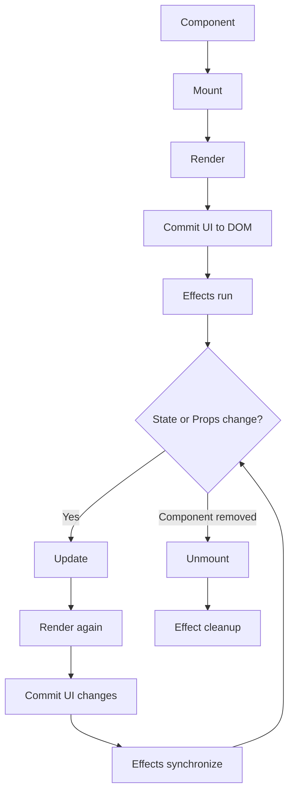
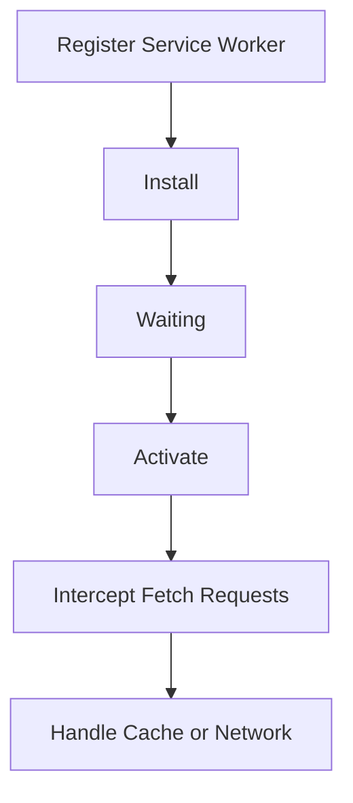
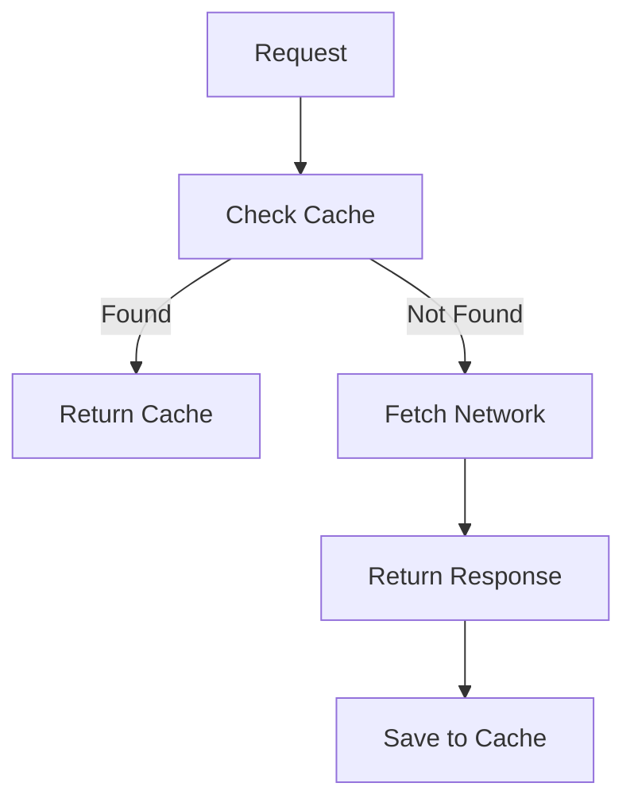
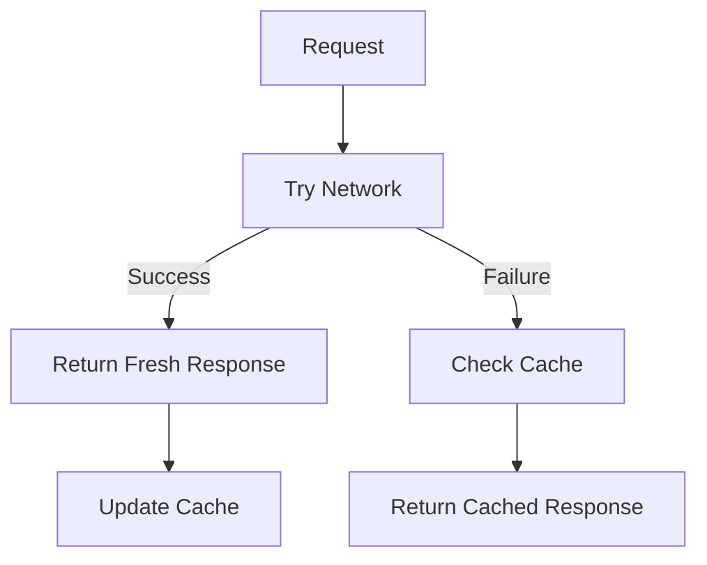
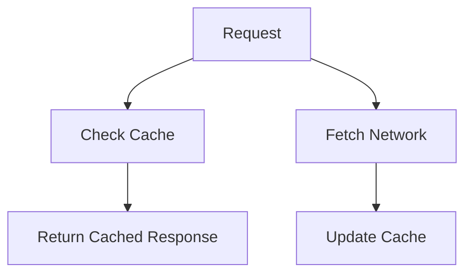
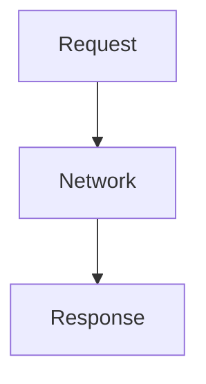
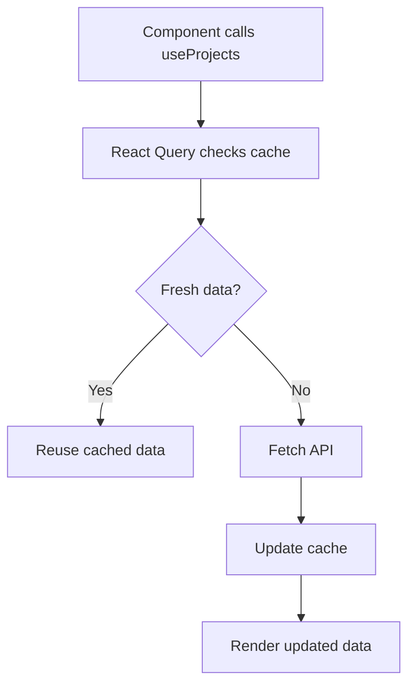
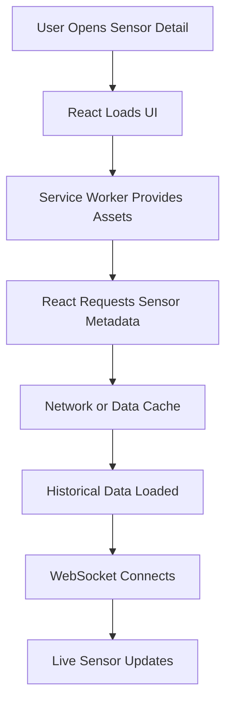
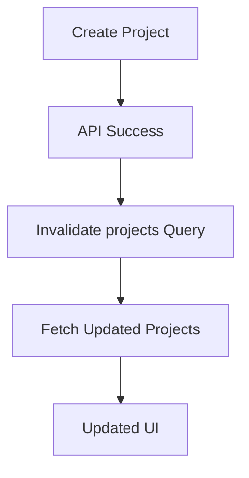
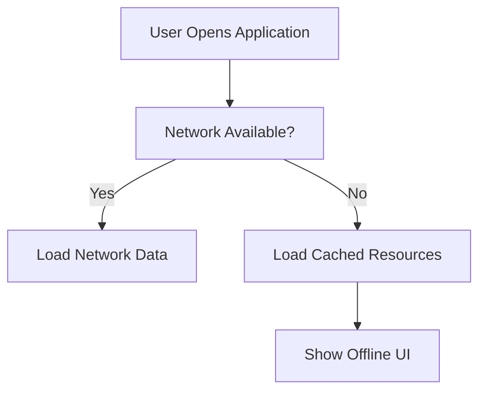

# React: Props vs State

This README explains **Props** and **State** in React in simple words, with practical examples and interview-focused explanations.

## Table of Contents

1. [What are Props?](#1-what-are-props)
2. [What is State?](#2-what-is-state)
3. [Props vs State](#3-props-vs-state)
4. [Using Props and State Together](#4-using-props-and-state-together)
5. [How Can a Child Update Parent State?](#5-how-can-a-child-update-parent-state)
6. [Lifting State Up](#6-lifting-state-up)
7. [Real-World Example](#7-real-world-example)
8. [Interview Answer](#8-interview-answer)
9. [Quick Revision](#9-quick-revision)

---

# 1. What are Props?

## Definition

Props (short for properties) are data passed from a parent component to a child component.

Props allow React components to communicate and share data.

Think of props as arguments passed to a function.

## Example

```jsx
function Welcome(props) {
    return <h1>Hello, {props.name}</h1>;
}

function App() {
    return <Welcome name="Vipul" />;
}
```

### Output

```text
Hello, Vipul
```

### How does it work?

1. `App` is the parent component.
2. `Welcome` is the child component.
3. `App` passes `name="Vipul"` to `Welcome`.
4. `Welcome` receives the value through `props`.
5. The component displays the received value.

### Component Flow

```text
App (Parent)
    |
    | Passes name="Vipul"
    | 
    v
Welcome (Child)
    |
    v
Hello, Vipul
```

## Using Props with Destructuring

Instead of:

```jsx
function Welcome(props) {
    return <h1>Hello, {props.name}</h1>;
}
```

We can write:

```jsx
function Welcome({ name }) {
    return <h1>Hello, {name}</h1>;
}
```

Destructuring allows us to directly extract values from the props object.

## Example with Multiple Props

```jsx
function UserProfile({ name, age, role }) {
    return (
        <div>
            <h2>{name}</h2>
            <p>Age: {age}</p>
            <p>Role: {role}</p>
        </div>
    );
}

function App() {
    return (
        <UserProfile
            name="Vipul"
            age={24}
            role="Full Stack Developer"
        />
    );
}
```

## Can a Child Modify Props?

Props should be treated as read-only by the receiving component.

A child component should not directly modify the props it receives.

However, a parent can render with new prop values, and the child can receive those updated values.

### Remember

**Props = Data passed from parent to child.**

---

# 2. What is State?

## Definition

State is data managed by a component or its state owner that can change over time.

State is used to store information that affects what is displayed on the UI.

Examples:

- Counter value
- Input field value
- Selected tab
- Modal visibility
- Shopping cart quantity
- Login status

In React functional components, we use the `useState()` Hook to manage state.

## Example: Counter

```jsx
import { useState } from "react";

function Counter() {
    const [count, setCount] = useState(0);

    return (
        <div>
            <h1>{count}</h1>

            <button onClick={() => setCount(count + 1)}>
                Increment
            </button>
        </div>
    );
}
```

### Output

Initially:

```text
0
```

After clicking the button:

```text
1
2
3
4
```

## Understanding useState()

```jsx
const [count, setCount] = useState(0);
```

| Part | Meaning |
|---|---|
| `count` | Current state value |
| `setCount` | Function used to update state |
| `0` | Initial state value |

### How does it work?

1. `useState(0)` initializes the state with `0`.
2. `count` contains the current state value.
3. `setCount()` updates the state.
4. React schedules a re-render.
5. The UI reflects the updated value.

## Updating State

```jsx
setCount(count + 1);
```

We should not directly modify state.

### Incorrect

```jsx
count = count + 1;
```

### Correct

```jsx
setCount(count + 1);
```

## Using Functional State Updates

When the next state depends on the previous state, we can use a functional update.

```jsx
setCount((previousCount) => previousCount + 1);
```

This is especially useful when multiple state updates depend on the previous value.

### Remember

**State = Data managed by a state owner that can change over time.**

---

# 3. Props vs State

| Props | State |
|---|---|
| Passed from parent to child | Managed by a component or state owner |
| Read-only for the receiving component | Updated using state setter functions |
| Used to pass data between components | Used to manage changing data |
| Parent provides the value | State owner controls the value |
| Similar to function arguments | Similar to component memory |
| Can change when the parent renders with new values | Can change when the state setter is called |

## Simple Comparison

```text
PROPS

Parent Component
      |
      | Passes data
      v
Child Component
      |
      v
Displays received data
```

```text
STATE

Component / State Owner
      |
      | Manages data
      v
State changes
      |
      v
React re-renders UI
```

### Props Example

```jsx
function UserProfile({ name }) {
    return <h1>{name}</h1>;
}

function App() {
    return <UserProfile name="Vipul" />;
}
```

Here, `name` is a prop.

### State Example

```jsx
import { useState } from "react";

function Counter() {
    const [count, setCount] = useState(0);

    return (
        <button onClick={() => setCount(count + 1)}>
            {count}
        </button>
    );
}
```

Here, `count` is state.

---

# 4. Using Props and State Together

Props and state can work together.

A parent component can maintain state and pass that state to a child component through props.

## Example

```jsx
import { useState } from "react";

function App() {
    const [username, setUsername] = useState("Vipul");

    return (
        <div>
            <UserProfile name={username} />
        </div>
    );
}

function UserProfile({ name }) {
    return <h1>Hello, {name}</h1>;
}
```

### How does it work?

1. `App` manages the state `username`.
2. `App` passes `username` to `UserProfile` as a prop.
3. `UserProfile` receives the value.
4. `UserProfile` displays the value.
5. If the parent's state changes, React renders again and the child can receive the updated prop.

### Flow

```text
App Component
    |
    | State: username = "Vipul"
    |
    | Passes username through props
    v
UserProfile Component
    |
    | Receives name
    v
Hello, Vipul
```

---

# 5. How Can a Child Update Parent State?

A child cannot directly modify the parent's state.

However, the parent can pass a function to the child through props.

The child can call that function to request an update to the parent's state.

## Example

```jsx
import { useState } from "react";

function App() {
    const [count, setCount] = useState(0);

    return (
        <div>
            <h1>Parent Count: {count}</h1>

            <Child
                onIncrement={() => setCount((prev) => prev + 1)}
            />
        </div>
    );
}

function Child({ onIncrement }) {
    return (
        <button onClick={onIncrement}>
            Increment Parent Count
        </button>
    );
}
```

### How does it work?

1. `App` owns the `count` state.
2. `App` passes `onIncrement` to `Child`.
3. The child calls `onIncrement` when the button is clicked.
4. The callback updates the parent's state.
5. React renders again with the new value.

### Flow

```text
Parent Component
    |
    | Owns count state
    |
    | Passes callback through props
    v
Child Component
    |
    | Calls callback
    v
Parent State Updated
    |
    v
React Re-render
```

### Remember

**Props can pass data down, and callback functions can allow children to trigger updates in the parent.**

---

# 6. Lifting State Up

## What is Lifting State Up?

Lifting state up means moving state from a child component to a common parent component when multiple components need access to the same state.

## Example

Imagine two components:

- `InputComponent` allows the user to enter a name.
- `DisplayComponent` displays that name.

If both components need the same data, we can maintain the state in their common parent.

```jsx
import { useState } from "react";

function App() {
    const [name, setName] = useState("");

    return (
        <div>
            <InputComponent name={name} setName={setName} />

            <DisplayComponent name={name} />
        </div>
    );
}

function InputComponent({ name, setName }) {
    return (
        <input
            value={name}
            onChange={(e) => setName(e.target.value)}
            placeholder="Enter your name"
        />
    );
}

function DisplayComponent({ name }) {
    return <h1>Hello, {name}</h1>;
}
```

### How does it work?

1. `App` owns the state.
2. `App` passes the value and setter function to `InputComponent`.
3. `InputComponent` updates the state through the setter function.
4. `App` passes the updated value to `DisplayComponent`.
5. `DisplayComponent` displays the updated value.

### Flow

```text
                 App
          (State: name)
             /     \
            /       \
           v         v
    InputComponent  DisplayComponent
       Updates       Displays
        State         Value
```

### Remember

**Lifting State Up = Move shared state to a common parent.**

---

# 7. Real-World Example

Imagine an e-commerce application.

## Props

We can pass product information to a ProductCard component.

```jsx
function ProductCard({ name, price, image }) {
    return (
        <div>
            

            <h2>{name}</h2>

            <p>Price: ₹{price}</p>
        </div>
    );
}

function App() {
    return (
        <ProductCard
            name="Laptop"
            price={50000}
            image="laptop.jpg"
        />
    );
}
```

Here:

- `name` is a prop.
- `price` is a prop.
- `image` is a prop.

## State

We can manage the quantity of a product.

```jsx
import { useState } from "react";

function ProductCard({ name, price }) {
    const [quantity, setQuantity] = useState(1);

    return (
        <div>
            <h2>{name}</h2>

            <p>Price: ₹{price}</p>

            <p>Quantity: {quantity}</p>

            <button
                onClick={() => setQuantity((prev) => prev + 1)}
            >
                Increase Quantity
            </button>

            <p>Total: ₹{price * quantity}</p>
        </div>
    );
}
```

Here:

- `name` and `price` are props.
- `quantity` is state.
- `setQuantity` updates the state.
- The total changes when quantity changes.

---

# 8. Interview Answer

## What is the difference between Props and State in React?

Props and state are both used to manage data in React, but they serve different purposes.

Props are data passed from a parent component to a child component. The receiving component treats props as read-only and uses them to render its UI.

State is data managed by a component or its state owner that can change over time. In functional components, we use the `useState` Hook to manage state. When state is updated, React schedules a re-render so the UI reflects the updated value.

For example, in a user profile component, the username can be passed as a prop from the parent, whereas the selected tab or input value can be maintained as state.

We can also pass callback functions as props to allow child components to trigger state updates in their parent components.

---

# 9. Quick Revision

| Concept | Meaning |
|---|---|
| Props | Data passed from parent to child |
| State | Data managed by a state owner |
| `useState()` | Hook used to manage state |
| State setter | Function used to update state |
| Re-render | React renders the component again based on updated data |
| Lifting state up | Moving shared state to a common parent |
| Callback props | Functions passed to children to trigger actions or updates |

## My Revision Shortcut

- **PROPS** → Data received
- **STATE** → Data managed
- **PROPS** → Parent to child
- **CALLBACKS** → Child can trigger parent updates
- **LIFTING STATE UP** → Move shared state to a common parent
- **`useState()`** → Manage state in functional components

---

## Final Takeaway

Props and state are fundamental concepts in React.

Props allow components to receive data from other components, while state allows a state owner to manage changing data.

Both work together to build dynamic, reusable and interactive React applications.


# React Hooks – `useState`, `useEffect`, `useMemo`, `useCallback`

## Table of Contents

- [What are React Hooks?](#what-are-react-hooks)
- [1. useState](#1-usestate)
- [2. useEffect](#2-useeffect)
- [3. useMemo](#3-usememo)
- [4. useCallback](#4-usecallback)
- [useMemo vs useCallback](#usememo-vs-usecallback)
- [React.memo](#reactmemo)
- [Real-World Example](#real-world-example)
- [Common Mistakes](#common-mistakes)
- [Interview Questions](#interview-questions)
- [Interview-Ready Explanation](#interview-ready-explanation)
- [Quick Revision](#quick-revision)

---

# What are React Hooks?

React Hooks are special functions that allow functional components to use React features such as state, side effects and performance optimizations.

Before Hooks, developers primarily used class components to manage state and lifecycle-related behavior.

Hooks allow us to use these features inside functional components.

### Commonly used Hooks

| Hook | Purpose |
|---|---|
| `useState` | Manage component state |
| `useEffect` | Handle side effects |
| `useMemo` | Memoize calculated values |
| `useCallback` | Memoize function references |

---

# 1. `useState`

## What is `useState`?

`useState` is a React Hook that allows us to store, manage and update data inside a functional component.

Think of it as the memory of a component.

For example:

- Counter value
- Form inputs
- Login status
- Modal visibility
- Selected dropdown value
- Shopping cart quantity

When state changes, React re-renders the component and updates the UI.

## Syntax

```jsx
const [state, setState] = useState(initialValue);
```

| Part | Meaning |
|---|---|
| `state` | Current state value |
| `setState` | Function used to update the state |
| `initialValue` | Initial value of the state |

## Example: Counter

```jsx
import { useState } from 'react';

function Counter() {
  const [count, setCount] = useState(0);

  return (
    <div>
      <h2>Count: {count}</h2>

      <button onClick={() => setCount(count + 1)}>
        Increase
      </button>

      <button onClick={() => setCount(count - 1)}>
        Decrease
      </button>
    </div>
  );
}

export default Counter;
```

## How does it work?

1. `useState(0)` initializes the count with `0`.
2. `count` contains the current value.
3. `setCount()` updates the state.
4. React re-renders the component when the state changes.
5. The UI displays the updated value.

## Updating state using the previous value

When the next state depends on the previous state, use the functional updater form.

```jsx
setCount(previousCount => previousCount + 1);
```

This is useful because React may batch multiple state updates.

### Example

```jsx
function Counter() {
  const [count, setCount] = useState(0);

  const increaseCount = () => {
    setCount(previousCount => previousCount + 1);
  };

  return (
    <button onClick={increaseCount}>
      {count}
    </button>
  );
}
```

## Interview Answer

`useState` is a React Hook that allows functional components to manage state. It returns the current state value and a setter function. When we update the state using the setter function, React schedules a re-render to update the UI.

---

# 2. `useEffect`

## What is `useEffect`?

`useEffect` is a React Hook used to handle side effects in functional components.

A side effect is an operation that interacts with something outside the component's normal rendering process.

### Common use cases

- Fetching data from APIs
- Setting timers
- Adding event listeners
- WebSocket connections
- Subscribing to events
- Updating document title

## Syntax

```jsx
useEffect(() => {
  // Side effect logic

  return () => {
    // Cleanup logic
  };
}, [dependencies]);
```

## Understanding the dependency array

### 1. Without dependency array

```jsx
useEffect(() => {
  console.log('Effect executed');
});
```

The Effect runs after every render.

### 2. Empty dependency array

```jsx
useEffect(() => {
  console.log('Component mounted');
}, []);
```

The Effect runs after the initial mount.

In development, React Strict Mode may run an additional setup and cleanup cycle to help identify bugs.

### 3. With dependencies

```jsx
useEffect(() => {
  console.log('Count changed');
}, [count]);
```

The Effect runs after the initial mount and when `count` changes.

## Example: Fetch API data

```jsx
import { useEffect, useState } from 'react';

function Users() {
  const [users, setUsers] = useState([]);
  const [loading, setLoading] = useState(true);

  useEffect(() => {
    async function fetchUsers() {
      try {
        const response = await fetch(
          'https://jsonplaceholder.typicode.com/users'
        );

        const data = await response.json();

        setUsers(data);
      } catch (error) {
        console.error(error);
      } finally {
        setLoading(false);
      }
    }

    fetchUsers();
  }, []);

  if (loading) {
    return <p>Loading...</p>;
  }

  return (
    <div>
      <h2>Users</h2>

      {users.map(user => (
        <p key={user.id}>{user.name}</p>
      ))}
    </div>
  );
}

export default Users;
```

## How does it work?

1. The component renders.
2. React commits the render.
3. The Effect executes.
4. The API request is made.
5. The API returns data.
6. `setUsers()` updates state.
7. React re-renders the component with the users.

## Cleanup function

Sometimes, we need to clean up something that we started.

For example:

- Stop timers
- Remove event listeners
- Disconnect WebSockets
- Cancel or ignore outdated asynchronous work

### Example: Timer

```jsx
import { useEffect } from 'react';

function Timer() {
  useEffect(() => {
    const timer = setInterval(() => {
      console.log('Hello');
    }, 1000);

    return () => {
      clearInterval(timer);
    };
  }, []);

  return <h2>Timer Component</h2>;
}
```

### How does cleanup work?

1. The timer starts when the component mounts.
2. The timer executes every second.
3. When the component unmounts, the cleanup function runs.
4. `clearInterval()` stops the timer.

## Interview Answer

`useEffect` is used to handle side effects in functional components. It is commonly used for API calls, timers, event listeners and subscriptions. It executes after React commits a render and uses a dependency array to control when it runs. It can also return a cleanup function to clean up resources.

---

# 3. `useMemo`

## What is `useMemo`?

`useMemo` is a React Hook that memoizes the result of a calculation.

Think of it as remembering the result of a calculation so that React doesn't need to perform the calculation again unnecessarily.

It is primarily used for performance optimization when calculations are expensive.

## Syntax

```jsx
const memoizedValue = useMemo(() => {
  return calculation();
}, [dependencies]);
```

| Part | Meaning |
|---|---|
| Function | Performs the calculation |
| Dependencies | Values that determine when the calculation should run again |
| Return value | The memoized calculation result |

## Example: Filtering employees

```jsx
import { useMemo, useState } from 'react';

const employees = [
  { name: 'Amit', salary: 40000 },
  { name: 'Rahul', salary: 60000 },
  { name: 'Sneha', salary: 80000 },
  { name: 'Priya', salary: 30000 }
];

function Employees() {
  const [count, setCount] = useState(0);

  const highSalaryEmployees = useMemo(() => {
    console.log('Filtering employees');

    return employees.filter(
      employee => employee.salary > 50000
    );
  }, []);

  return (
    <div>
      <h2>High Salary Employees</h2>

      {highSalaryEmployees.map(employee => (
        <p key={employee.name}>
          {employee.name} - {employee.salary}
        </p>
      ))}

      <button onClick={() => setCount(count + 1)}>
        Counter: {count}
      </button>
    </div>
  );
}

export default Employees;
```

## How does it work?

1. React executes the calculation on the initial render.
2. React stores the calculated result.
3. When the component re-renders, React checks the dependencies.
4. If dependencies haven't changed, React reuses the previous result.
5. If dependencies change, React calculates the value again.

In the above example, clicking the counter doesn't require filtering the employees again because the employee array is defined outside the component and the dependencies are unchanged.

## Example with dependencies

```jsx
import { useMemo, useState } from 'react';

const employees = [
  { name: 'Amit', salary: 40000 },
  { name: 'Rahul', salary: 60000 },
  { name: 'Sneha', salary: 80000 }
];

function Employees() {
  const [minimumSalary, setMinimumSalary] = useState(50000);

  const filteredEmployees = useMemo(() => {
    return employees.filter(
      employee => employee.salary > minimumSalary
    );
  }, [minimumSalary]);

  return (
    <div>
      <input
        type="number"
        value={minimumSalary}
        onChange={event =>
          setMinimumSalary(Number(event.target.value))
        }
      />

      {filteredEmployees.map(employee => (
        <p key={employee.name}>
          {employee.name} - {employee.salary}
        </p>
      ))}
    </div>
  );
}
```

Here, the calculation runs again when `minimumSalary` changes.

## When should we use `useMemo`?

Use it when:

- A calculation is expensive.
- Filtering or sorting large datasets.
- A computed value is passed to a memoized child and referential stability matters.
- You have identified a performance problem and memoization helps.

Don't use it for every calculation. Most simple calculations don't require memoization.

## Interview Answer

`useMemo` is a performance optimization Hook that memoizes the result of a calculation. It recalculates the value only when its dependencies change, helping avoid unnecessary expensive calculations during re-renders.

---

# 4. `useCallback`

## What is `useCallback`?

`useCallback` is a React Hook that memoizes a function reference.

Think of it as remembering the function itself instead of creating a new function reference on every render.

It is useful when passing functions to memoized child components or when a stable function reference is required.

## Syntax

```jsx
const memoizedFunction = useCallback(() => {
  // Function logic
}, [dependencies]);
```

## Example

```jsx
import { useCallback, useState } from 'react';

function Parent() {
  const [count, setCount] = useState(0);

  const handleClick = useCallback(() => {
    console.log('Button clicked');
  }, []);

  return (
    <div>
      <h2>Count: {count}</h2>

      <button onClick={() => setCount(count + 1)}>
        Increase
      </button>

      <Child onClick={handleClick} />
    </div>
  );
}

function Child({ onClick }) {
  console.log('Child rendered');

  return (
    <button onClick={onClick}>
      Click Child
    </button>
  );
}

export default Parent;
```

In this example, `handleClick` is memoized.

However, the child can still re-render when the parent re-renders. `useCallback` alone doesn't prevent child re-renders.

## `useCallback` with `React.memo`

```jsx
import React, { useCallback, useState } from 'react';

function Parent() {
  const [count, setCount] = useState(0);

  const handleClick = useCallback(() => {
    console.log('Button clicked');
  }, []);

  return (
    <div>
      <h2>Count: {count}</h2>

      <button onClick={() => setCount(count + 1)}>
        Increase
      </button>

      <Child onClick={handleClick} />
    </div>
  );
}

const Child = React.memo(function Child({ onClick }) {
  console.log('Child rendered');

  return (
    <button onClick={onClick}>
      Click Child
    </button>
  );
});

export default Parent;
```

## How does it work?

1. The parent component renders.
2. React creates the function during the initial render and stores its reference.
3. When the parent re-renders, React checks the dependencies.
4. If dependencies haven't changed, React reuses the previous function reference.
5. `React.memo` compares the child's props.
6. If the props haven't changed, the child can skip re-rendering.

## When should we use `useCallback`?

Use it when:

- Passing functions to memoized child components.
- Preventing unnecessary child re-renders when referential stability matters.
- A function is used as a dependency in another Hook.
- You have identified a performance issue where a stable callback helps.

## Interview Answer

`useCallback` is a React Hook that memoizes a function reference and returns the same function between renders until its dependencies change. It is useful for performance optimization, especially when passing functions to memoized child components.

---

# useMemo vs useCallback

Both Hooks are used for performance optimization, but they memoize different things.

| Feature | `useMemo` | `useCallback` |
|---|---|---|
| What does it memoize? | A calculated value | A function reference |
| What does it return? | Memoized result | Memoized function |
| Main purpose | Avoid recalculations | Maintain stable function references |
| Typical example | Filtering large arrays | Passing callbacks to child components |

### `useMemo`

```jsx
const value = useMemo(() => {
  return calculateValue();
}, [dependency]);
```

It remembers the result of the calculation.

### `useCallback`

```jsx
const handleClick = useCallback(() => {
  doSomething();
}, [dependency]);
```

It remembers the function reference.

### Easy way to remember

- `useMemo` = Remember the value.
- `useCallback` = Remember the function.

---

# React.memo

## What is `React.memo`?

`React.memo` is a React API that allows a component to skip re-rendering when its props haven't changed.

It is useful for optimizing components that receive the same props frequently.

## Example

```jsx
import React from 'react';

const Child = React.memo(function Child({ name }) {
  console.log('Child rendered');

  return <h2>Hello {name}</h2>;
});

export default Child;
```

If the `name` prop remains unchanged, React can skip re-rendering the child when its parent renders again.

### Important

- `React.memo` memoizes a component based on its props.
- `useMemo` memoizes a calculated value.
- `useCallback` memoizes a function reference.

They are related, but they solve different problems.

---

# Real-World Example

## Product Card

Imagine an e-commerce application.

We have:

- Product name
- Product price
- Quantity
- Total price
- An increment button

We can use `useState` for quantity and `useMemo` for calculating the total price.

```jsx
import { useMemo, useState } from 'react';

function ProductCard() {
  const [quantity, setQuantity] = useState(1);

  const price = 1000;

  const totalPrice = useMemo(() => {
    return price * quantity;
  }, [price, quantity]);

  return (
    <div>
      <h2>Product: Laptop</h2>

      <p>Price: ₹{price}</p>

      <p>Quantity: {quantity}</p>

      <button onClick={() => setQuantity(q => q + 1)}>
        Increase Quantity
      </button>

      <button
        onClick={() =>
          setQuantity(q => Math.max(1, q - 1))
        }
      >
        Decrease Quantity
      </button>

      <h3>Total: ₹{totalPrice}</h3>
    </div>
  );
}

export default ProductCard;
```

### Hooks used

| Hook | Usage |
|---|---|
| `useState` | Manage quantity |
| `useMemo` | Calculate total price |

Note: The total price calculation is very simple, so `useMemo` isn't necessary in this particular example. It is included to demonstrate how it works.

---

# Common Mistakes

## 1. Updating state directly

Incorrect:

```jsx
count = count + 1;
```

Correct:

```jsx
setCount(count + 1);
```

React state should be updated using the state setter.

---

## 2. Using `useEffect` without understanding dependencies

```jsx
useEffect(() => {
  fetchData();
}, []);
```

The empty dependency array means the Effect runs after the initial mount, not every time any state changes.

---

## 3. Using `useMemo` everywhere

Incorrect mindset:

> Every calculation should use `useMemo`.

Correct mindset:

> Use `useMemo` when a calculation is expensive or memoization is beneficial for performance.

---

## 4. Thinking `useCallback` prevents re-renders

`useCallback` does not directly prevent a component from re-rendering.

It memoizes a function reference.

For a child component to skip rendering based on unchanged props, `React.memo` may also be useful.

---

## 5. Missing dependencies

```jsx
useEffect(() => {
  console.log(count);
}, []);
```

If the Effect is supposed to react to changes in `count`, then `count` should be included in the dependency array.

```jsx
useEffect(() => {
  console.log(count);
}, [count]);
```

Always follow the dependency rules and lint recommendations.

---

# Interview Questions

## 1. What are React Hooks?

React Hooks are functions that allow functional components to use React features such as state, side effects and other functionality.

## 2. What is `useState`?

`useState` is used to manage state inside functional components. It returns the current state and a setter function.

## 3. What is `useEffect`?

`useEffect` is used to handle side effects such as API calls, timers, event listeners and subscriptions.

## 4. What is the difference between `useEffect` with an empty dependency array and without a dependency array?

- Empty dependency array: runs after the initial mount.
- No dependency array: runs after every render.

## 5. What is `useMemo`?

`useMemo` memoizes the result of a calculation and recalculates it when its dependencies change.

## 6. What is `useCallback`?

`useCallback` memoizes a function reference and returns the same function between renders until dependencies change.

## 7. What is the difference between `useMemo` and `useCallback`?

`useMemo` memoizes a calculated value, whereas `useCallback` memoizes a function reference.

## 8. Does `useCallback` prevent re-renders?

No. It memoizes a function reference. `React.memo` can help a child component skip re-rendering when its props remain unchanged.

## 9. What is the purpose of the cleanup function in `useEffect`?

It cleans up resources such as timers, subscriptions and event listeners when the Effect is cleaned up.

## 10. Can we use Hooks inside loops or conditions?

No. Hooks should be called at the top level of React function components or custom Hooks, not inside loops, conditions or nested functions.

## 11. What is `React.memo`?

`React.memo` is used to memoize a component so React can skip re-rendering it when its props remain unchanged.

## 12. What is the difference between state and props?

- State is managed by a component or its state owner.
- Props are values passed from a parent component to a child component.

---

# Interview-Ready Explanation

If an interviewer asks you to explain these Hooks, you can answer:

> React Hooks allow us to use React features inside functional components.
>
> `useState` is used to manage component state, such as form data, counters and UI visibility. Whenever state changes, React re-renders the component.
>
> `useEffect` is used to handle side effects such as API calls, event listeners, timers and subscriptions. We can control when it executes using the dependency array and return a cleanup function when necessary.
>
> `useMemo` is used to memoize the result of a calculation to avoid unnecessary recalculations when dependencies haven't changed.
>
> `useCallback` is used to memoize a function reference. It is particularly useful when passing callbacks to memoized child components to avoid unnecessary re-renders.
>
> I use `useMemo` and `useCallback` primarily when there is a performance benefit, rather than using them everywhere.

---

# Quick Revision

| Hook | Remember | Example |
|---|---|---|
| `useState` | Data | Counter, form |
| `useEffect` | Side effects | API call, timer |
| `useMemo` | Value | Filter, sort, calculation |
| `useCallback` | Function | Callback prop |
| `React.memo` | Component | Avoid unnecessary child render |

### Easy mnemonic

- **State** → Store data.
- **Effect** → Do something after render.
- **Memo** → Remember a calculated value.
- **Callback** → Remember a function.
- **Memo component** → Skip rendering when props haven't changed.

---

## Recommended learning order

1. `useState`
2. `useEffect`
3. Props and State
4. Conditional Rendering
5. Lists and Keys
6. `useMemo`
7. `useCallback`
8. `React.memo`
9. Custom Hooks

---


# React Component Lifecycle

## Table of Contents

- [What is Component Lifecycle?](#what-is-component-lifecycle)
- [Three Main Lifecycle Stages](#three-main-lifecycle-stages)
- [1. Mounting](#1-mounting)
- [2. Updating](#2-updating)
- [3. Unmounting](#3-unmounting)
- [Component Lifecycle Diagram](#component-lifecycle-diagram)
- [Lifecycle in Class Components](#lifecycle-in-class-components)
- [Lifecycle in Functional Components](#lifecycle-in-functional-components)
- [useEffect and Lifecycle](#useeffect-and-lifecycle)
- [Real-World Example](#real-world-example)
- [Common Mistakes](#common-mistakes)
- [Interview Questions](#interview-questions)
- [Interview-Ready Explanation](#interview-ready-explanation)
- [Quick Revision](#quick-revision)

---

# What is Component Lifecycle?

The Component Lifecycle in React refers to the different stages a component goes through during its existence in a React application.

Think of a React component like a person:

- **Birth**: The component appears on the screen.
- **Growing/Changing**: The component's data changes and the UI updates.
- **Death**: The component is removed from the screen.

In React, these stages are called:

1. Mounting
2. Updating
3. Unmounting

---

# Three Main Lifecycle Stages

| Lifecycle Stage | Meaning |
|---|---|
| Mounting | Component appears on the screen for the first time |
| Updating | Component re-renders because something changes |
| Unmounting | Component is removed from the screen |

---

# 1. Mounting

## What is Mounting?

Mounting is the process of creating a component and displaying it on the screen for the first time.

For example, when we open a dashboard, React displays:

- Header
- Sidebar
- Dashboard cards
- Charts

When these components are initially displayed, they are mounting.

## Example

```jsx
function Welcome() {
  return <h1>Hello, Welcome!</h1>;
}

export default Welcome;
```

When React displays the `Welcome` component for the first time, the component mounts.

## What happens during mounting?

1. React executes the component.
2. React calculates what UI should be displayed.
3. React commits the UI to the DOM.
4. Effects such as `useEffect` run after the commit.

## Using useEffect during Mounting

```jsx
import { useEffect } from 'react';

function Dashboard() {
  useEffect(() => {
    console.log('Dashboard mounted');
  }, []);

  return <h1>Dashboard</h1>;
}

export default Dashboard;
```

### Explanation

```jsx
useEffect(() => {
  console.log('Dashboard mounted');
}, []);
```

The empty dependency array means the Effect runs after the initial mount.

In development, React Strict Mode may perform an extra setup and cleanup cycle for Effects.

---

# 2. Updating

## What is Updating?

Updating happens when React re-renders a component because something has changed.

A component may update when:

- Its state changes.
- It receives different props.
- Its parent renders again, unless React can skip the render through an optimization.

## Example: Counter

```jsx
import { useState } from 'react';

function Counter() {
  const [count, setCount] = useState(0);

  return (
    <div>
      <h2>Count: {count}</h2>

      <button onClick={() => setCount(count + 1)}>
        Increase
      </button>
    </div>
  );
}

export default Counter;
```

## What happens when we click Increase?

1. Initially, `count` is `0`.
2. We click the Increase button.
3. `setCount()` updates the state.
4. React schedules a re-render.
5. React executes the component again.
6. React updates the necessary DOM parts.
7. The UI displays the new count.

## Using useEffect during Updating

```jsx
import { useEffect, useState } from 'react';

function Counter() {
  const [count, setCount] = useState(0);

  useEffect(() => {
    console.log('Count changed:', count);
  }, [count]);

  return (
    <button onClick={() => setCount(count + 1)}>
      Count: {count}
    </button>
  );
}

export default Counter;
```

### Explanation

```jsx
useEffect(() => {
  console.log('Count changed:', count);
}, [count]);
```

This Effect runs after the initial mount and whenever `count` changes.

---

# 3. Unmounting

## What is Unmounting?

Unmounting means React removes a component from the screen because it is no longer needed.

For example:

- Closing a modal.
- Navigating to another page.
- Hiding a component.
- Removing an item from a list.

## Example

```jsx
import { useState } from 'react';

function App() {
  const [show, setShow] = useState(true);

  return (
    <div>
      <button onClick={() => setShow(!show)}>
        Toggle Component
      </button>

      {show && <Child />}
    </div>
  );
}

function Child() {
  return <h2>I am a child component</h2>;
}

export default App;
```

## How does it work?

Initially:

```jsx
{show && <Child />}
```

Because `show` is `true`, React displays the `Child` component.

When the button is clicked:

```jsx
setShow(false);
```

React removes the `Child` component from the screen.

This process is called unmounting.

## Cleanup during Unmounting

We can use the cleanup function inside `useEffect` to clean up resources.

```jsx
import { useEffect } from 'react';

function Child() {
  useEffect(() => {
    console.log('Child mounted');

    return () => {
      console.log('Child unmounted');
    };
  }, []);

  return <h2>Child Component</h2>;
}
```

### Explanation

When the component appears:

```jsx
console.log('Child mounted');
```

When the component is removed:

```jsx
return () => {
  console.log('Child unmounted');
};
```

The cleanup function executes when the Effect is cleaned up.

Cleanup is useful for:

- Clearing timers.
- Removing event listeners.
- Disconnecting WebSockets.
- Cleaning up subscriptions.

---

# Component Lifecycle Diagram



## Simple Lifecycle Flow

| Stage | What Happens? |
|---|---|
| Mount | Component appears |
| Update | Component renders again due to changes |
| Unmount | Component is removed |

---

# Lifecycle in Class Components

Before Hooks, React developers primarily handled lifecycle behavior using class component methods.

There are three commonly discussed lifecycle methods:

| Method | Lifecycle Stage | Purpose |
|---|---|---|
| `componentDidMount()` | Mounting | Executes after the component mounts |
| `componentDidUpdate()` | Updating | Executes after an update |
| `componentWillUnmount()` | Unmounting | Executes before the component is removed |

## Example

```jsx
import React from 'react';

class Counter extends React.Component {
  constructor(props) {
    super(props);

    this.state = {
      count: 0
    };
  }

  componentDidMount() {
    console.log('Component mounted');
  }

  componentDidUpdate() {
    console.log('Component updated');
  }

  componentWillUnmount() {
    console.log('Component unmounted');
  }

  render() {
    return (
      <div>
        <h2>{this.state.count}</h2>

        <button
          onClick={() =>
            this.setState({ count: this.state.count + 1 })
          }
        >
          Increase
        </button>
      </div>
    );
  }
}

export default Counter;
```

## Explanation

### `constructor()`

Used to initialize state and bind methods in class components.

### `render()`

Returns the UI that React should display.

### `componentDidMount()`

Runs after the component is mounted.

Common use cases:

- API calls
- Initial setup
- Subscriptions

### `componentDidUpdate()`

Runs after the component updates.

Common use cases:

- Responding to prop or state changes
- Updating external systems

### `componentWillUnmount()`

Runs before the component is removed.

Common use cases:

- Clearing timers
- Removing event listeners
- Disconnecting subscriptions

---

# Lifecycle in Functional Components

In modern React, we generally use functional components and Hooks.

| Class Component | Functional Component |
|---|---|
| `componentDidMount()` | Often represented by `useEffect(() => {}, [])` |
| `componentDidUpdate()` | Often represented by `useEffect(() => {}, [dependencies])` |
| `componentWillUnmount()` | Cleanup function returned by `useEffect` |

These are conceptual comparisons, not exact replacements. Effects synchronize with external systems and can start and stop multiple times while a component is mounted.

## Example

```jsx
import { useEffect, useState } from 'react';

function Counter() {
  const [count, setCount] = useState(0);

  useEffect(() => {
    console.log('Effect executed');

    return () => {
      console.log('Effect cleanup');
    };
  }, [count]);

  return (
    <div>
      <h2>Count: {count}</h2>

      <button onClick={() => setCount(count + 1)}>
        Increase
      </button>
    </div>
  );
}

export default Counter;
```

## How does it work?

1. The component mounts.
2. The Effect runs.
3. The user clicks Increase.
4. The state changes.
5. React renders the component again.
6. React cleans up the previous Effect.
7. React runs the Effect again with the updated `count`.
8. When the component unmounts, the cleanup function runs.

---

# useEffect and Lifecycle

## 1. useEffect without dependency array

```jsx
useEffect(() => {
  console.log('Effect executed');
});
```

Runs after every render.

## 2. useEffect with an empty dependency array

```jsx
useEffect(() => {
  console.log('Component mounted');
}, []);
```

Runs after the initial mount.

## 3. useEffect with dependencies

```jsx
useEffect(() => {
  console.log('Count changed');
}, [count]);
```

Runs after the initial mount and whenever `count` changes.

## 4. useEffect with cleanup

```jsx
useEffect(() => {
  const timer = setInterval(() => {
    console.log('Hello');
  }, 1000);

  return () => {
    clearInterval(timer);
  };
}, []);
```

The cleanup function clears the timer when the Effect is cleaned up.

---

# Real-World Example

## Dashboard Lifecycle

Imagine we are developing a dashboard in React.

### 1. Mounting

The dashboard component appears on the screen.

### 2. API Call

An Effect fetches data from the backend.

### 3. Updating

When the API returns data, state is updated and React renders the charts and cards.

### 4. User Interaction

The user selects a country filter.

The state changes and React updates the UI.

### 5. Unmounting

The user leaves the dashboard.

React removes the component and Effects clean up resources.

---

# Common Mistakes

## 1. Thinking the entire DOM is recreated

React doesn't recreate the entire DOM from scratch on every state change.

React renders again, reconciles the result and commits the necessary DOM updates.

## 2. Using useEffect for everything

Not every operation needs `useEffect`.

For example, calculations based on props or state can often be performed during rendering or derived directly from existing state.

## 3. Forgetting cleanup

Incorrect:

```jsx
useEffect(() => {
  const timer = setInterval(() => {
    console.log('Hello');
  }, 1000);
}, []);
```

The timer is not cleaned up.

Correct:

```jsx
useEffect(() => {
  const timer = setInterval(() => {
    console.log('Hello');
  }, 1000);

  return () => clearInterval(timer);
}, []);
```

## 4. Thinking useEffect is exactly the same as lifecycle methods

`useEffect` is designed to synchronize a component with external systems.

It doesn't directly map one-to-one to every class lifecycle method.

---

# Interview Questions

## 1. What is the component lifecycle in React?

The component lifecycle represents the stages a component goes through: mounting, updating and unmounting.

## 2. What is mounting?

Mounting is when a component is displayed on the screen for the first time.

## 3. What is updating?

Updating happens when React re-renders a component due to state changes, prop changes or other rendering conditions.

## 4. What is unmounting?

Unmounting is when React removes a component from the screen.

## 5. What is componentDidMount?

It is a class lifecycle method that executes after the component mounts.

## 6. What is componentDidUpdate?

It is a class lifecycle method that executes after a component updates.

## 7. What is componentWillUnmount?

It is a class lifecycle method that executes before a component is removed.

## 8. How do functional components handle lifecycle-related behavior?

Functional components use Hooks such as `useEffect` to synchronize with external systems, perform setup and handle cleanup.

## 9. Why is cleanup important?

Cleanup prevents unwanted resource usage from timers, subscriptions and event listeners that are no longer needed.

## 10. Does every state change mean the entire DOM is recreated?

No. React renders again, reconciles the result and commits necessary DOM changes.

## 11. What is the difference between mounting and updating?

Mounting is the first time a component appears on the screen. Updating happens when a component renders again due to changes.

## 12. Can useEffect run more than once?

Yes. It can run after the initial mount, when dependencies change, and it may run additional setup-cleanup cycles in React Strict Mode during development.

---

# Interview-Ready Explanation

If an interviewer asks:

**"Explain the component lifecycle in React."**

You can answer:

> In React, the component lifecycle refers to the different stages a component goes through during its existence. It consists of three main stages: mounting, updating and unmounting.
>
> Mounting is when a component is displayed on the screen for the first time. Updating happens when the component re-renders due to changes in state, props or other rendering conditions. Unmounting happens when the component is removed from the screen.
>
> In class components, we use lifecycle methods such as `componentDidMount`, `componentDidUpdate` and `componentWillUnmount` to handle these stages.
>
> In functional components, we generally use Hooks such as `useEffect` to synchronize with external systems, perform setup and handle cleanup. For example, I can use an Effect to fetch data, synchronize when dependencies change, and return a cleanup function to clear timers or disconnect subscriptions.
>
> In modern React development, I primarily work with functional components and Hooks.

---

# Quick Revision

| Concept | Meaning |
|---|---|
| Mounting | Component appears |
| Updating | Component changes |
| Unmounting | Component disappears |
| `componentDidMount` | After mounting in class components |
| `componentDidUpdate` | After updating in class components |
| `componentWillUnmount` | Before unmounting in class components |
| `useEffect` | Synchronize with external systems and handle setup/cleanup |

### Easy way to remember

- **Mount** = Birth
- **Update** = Change
- **Unmount** = Removal

---

## Recommended Next Topics

1. Virtual DOM
2. React Reconciliation
3. React Rendering
4. React.memo
5. Props vs State
6. Context API
7. Custom Hooks

---


# PWA Architecture, Service Workers, Manifest & Cache Strategies

## Table of Contents

1. [What is a PWA?](#1-what-is-a-pwa)
2. [Normal Website vs PWA](#2-normal-website-vs-pwa)
3. [PWA Architecture](#3-pwa-architecture)
4. [What is a Service Worker?](#4-what-is-a-service-worker)
5. [Service Worker Lifecycle](#5-service-worker-lifecycle)
6. [Service Worker Registration](#6-service-worker-registration)
7. [What is a Web App Manifest?](#7-what-is-a-web-app-manifest)
8. [Manifest File Configuration](#8-manifest-file-configuration)
9. [What is Cache?](#9-what-is-cache)
10. [Cache API](#10-cache-api)
11. [Cache Strategies](#11-cache-strategies)
12. [Cache First](#12-cache-first)
13. [Network First](#13-network-first)
14. [Stale While Revalidate](#14-stale-while-revalidate)
15. [Network Only](#15-network-only)
16. [Where to Implement Cache in a Dashboard](#16-where-to-implement-cache-in-a-dashboard)
17. [Service Worker Cache vs React Query](#17-service-worker-cache-vs-react-query)
18. [React Query Implementation](#18-react-query-implementation)
19. [Implementing PWA Using Workbox](#19-implementing-pwa-using-workbox)
20. [Caching Sensor Data](#20-caching-sensor-data)
21. [Cache Invalidation](#21-cache-invalidation)
22. [Offline Support](#22-offline-support)
23. [PWA Updates](#23-pwa-updates)
24. [Security Considerations](#24-security-considerations)
25. [Common Mistakes](#25-common-mistakes)
26. [Interview Questions](#26-interview-questions)
27. [Interview-Ready Answers](#27-interview-ready-answers)
28. [Quick Revision](#28-quick-revision)
29. [Learning Roadmap](#29-learning-roadmap)

---

# 1. What is a PWA?

A Progressive Web App (PWA) is a web application that provides an app-like experience using web technologies.

A PWA can provide features such as:

- Installability
- Offline support
- Caching
- Faster loading
- App-like UI
- Push notifications
- Background capabilities

A PWA is still a web application, but it uses browser capabilities to behave more like an installed application.

### Example

Normally, a user opens a website using Chrome.

With a PWA, the user can:

1. Open the website.
2. Install it on their device.
3. Open it from the desktop or home screen.
4. Use certain features even without an internet connection.

---

# 2. Normal Website vs PWA

| Feature | Normal Website | PWA |
|---|---|---|
| Opens in browser | Yes | Yes |
| Installable | Usually not | Yes |
| Offline support | Limited by implementation | Possible |
| Caching | Possible | Commonly implemented |
| App-like experience | Limited | Yes |
| Push notifications | Limited | Possible |
| Background capabilities | Limited | Some browser APIs |

---

# 3. PWA Architecture

A traditional application typically has:

```text
User
  |
  v
React Frontend
  |
  v
Backend API
  |
  v
Database
```

A PWA introduces a Service Worker and caching mechanisms.

```text
                    USER
                     |
                     v
              REACT FRONTEND
                     |
                     v
              SERVICE WORKER
                     |
          +----------+----------+
          |                     |
          v                     v
     LOCAL CACHE              NETWORK
          |                     |
          |                     v
          |                 BACKEND API
          |                     |
          |                     v
          |                  DATABASE
          |
          v
    CACHED RESPONSE
```

The Service Worker can intercept certain requests and decide whether to return cached content or fetch from the network.

### PWA Architecture Components

| Component | Responsibility |
|---|---|
| React Frontend | UI and user interaction |
| Service Worker | Request interception and offline support |
| Cache API | Store selected request/response resources |
| Web App Manifest | Installation and app presentation configuration |
| Backend | Business logic and APIs |
| Database | Store application data |
| React Query | API state management and data caching |
| WebSocket | Real-time communication |

---

# 4. What is a Service Worker?

A Service Worker is a JavaScript file that runs separately from the main webpage and can intercept certain network requests.

It acts as a background request manager between the frontend and the network.

### Without Service Worker

```text
React Application
       |
       v
    Network
       |
       v
    Backend
```

### With Service Worker

```text
React Application
       |
       v
   Service Worker
       |
       +------> Cache
       |
       +------> Network
```

### What can a Service Worker do?

- Intercept network requests.
- Cache application resources.
- Cache selected API responses.
- Provide offline support.
- Return cached content when the network is unavailable.
- Support background sync where available.
- Support push notifications where available.

### Important Characteristics

| Property | Explanation |
|---|---|
| Separate execution context | Doesn't run directly on the React UI thread |
| No DOM access | Cannot directly manipulate the webpage DOM |
| Event-driven | Responds to supported events |
| HTTPS | Requires a secure context, except localhost |
| Request interception | Can intercept requests within its scope |
| Lifecycle | Install, activate and fetch events |
| Cache API | Can store resources locally |

---

# 5. Service Worker Lifecycle

The Service Worker lifecycle consists of multiple stages.



## 1. Register

The application registers the Service Worker.

## 2. Install

The browser downloads and installs the Service Worker.

During installation, essential resources can be cached.

## 3. Waiting

A new Service Worker may wait until the previous worker no longer controls active clients, depending on the update lifecycle.

## 4. Activate

The new Service Worker becomes active.

Old caches can be cleaned up during this stage.

## 5. Fetch

The Service Worker intercepts eligible requests and applies caching strategies.

---

# 6. Service Worker Registration

Service Workers are generally registered from the frontend.

### Example

```javascript
if ("serviceWorker" in navigator) {
  navigator.serviceWorker
    .register("/service-worker.js")
    .then((registration) => {
      console.log("Service Worker registered:", registration);
    })
    .catch((error) => {
      console.error("Service Worker registration failed:", error);
    });
}
```

### What happens?

1. Browser checks whether Service Workers are supported.
2. Browser registers the Service Worker.
3. Browser downloads the Service Worker file.
4. Browser installs and activates it.
5. The worker can control eligible pages within its scope.

---

# 7. What is a Web App Manifest?

The Web App Manifest is a JSON file that defines how the application should behave when installed.

It provides configuration such as:

- Application name
- Short name
- Icons
- Theme color
- Background color
- Start URL
- Display mode

The Manifest does not implement caching.

It primarily configures the installable application experience.

---

# 8. Manifest File Configuration

### manifest.json

```json
{
  "name": "Sensor Monitoring Dashboard",
  "short_name": "Sensor App",
  "description": "Industrial sensor monitoring application",
  "start_url": "/",
  "display": "standalone",
  "background_color": "#ffffff",
  "theme_color": "#2563eb",
  "icons": [
    {
      "src": "/icons/icon-192.png",
      "sizes": "192x192",
      "type": "image/png"
    },
    {
      "src": "/icons/icon-512.png",
      "sizes": "512x512",
      "type": "image/png"
    }
  ]
}
```

### Property Explanation

| Property | Explanation |
|---|---|
| `name` | Application name |
| `short_name` | Short name |
| `description` | Application description |
| `start_url` | Page opened when launching the app |
| `display` | Application display mode |
| `background_color` | Background color |
| `theme_color` | UI theme color |
| `icons` | Application icons |

### Display Modes

| Value | Explanation |
|---|---|
| `browser` | Opens with browser UI |
| `standalone` | Opens like an installed application |
| `fullscreen` | Uses the full screen |
| `minimal-ui` | Minimal browser controls where supported |

### Linking the Manifest

In `index.html`:

```html
<link rel="manifest" href="/manifest.json" />
```

### Suggested Project Structure

```text
my-pwa/
│
├── public/
│   ├── manifest.json
│   ├── service-worker.js
│   └── icons/
│       ├── icon-192.png
│       └── icon-512.png
│
├── src/
│   ├── App.jsx
│   ├── main.jsx
│   └── ...
│
└── package.json
```

---

# 9. What is Cache?

Cache means storing resources locally so they can be reused without fetching them from the original source every time.

For example, a frontend application may download:

- JavaScript
- CSS
- Images
- Fonts
- API responses

Some resources don't change frequently.

Instead of downloading them repeatedly, we can store them locally.

### Without Cache

```text
User Opens Application
        |
        v
      Server
        |
        v
Download Resources
```

### With Cache

```text
User Opens Application
        |
        v
       Cache
        |
        v
Resource Available?
        |
    +---+---+
    |       |
   Yes      No
    |       |
    v       v
Return    Network
Cache
```

---

# 10. Cache API

The Cache API allows a Service Worker to store and retrieve request/response pairs.

Common operations include:

- `caches.open()`
- `cache.put()`
- `cache.add()`
- `cache.addAll()`
- `cache.match()`
- `caches.match()`
- `caches.delete()`
- `caches.keys()`

### Example

```javascript
const cache = await caches.open("static-cache-v1");

await cache.put("/logo.png", response);
```

### Retrieve Cached Response

```javascript
const cachedResponse = await caches.match("/logo.png");
```

### Delete Cache

```javascript
await caches.delete("static-cache-v1");
```

### Cache API vs LocalStorage

| Cache API | LocalStorage |
|---|---|
| Stores request/response pairs | Stores key-value strings |
| Useful for resources | Useful for simple application settings |
| Supports Response objects | Stores strings |
| Commonly used by Service Workers | Commonly used by frontend JS |
| Can store larger resources, subject to browser storage limits | Generally limited in capacity |

---

# 11. Cache Strategies

Different resources require different caching strategies.

| Strategy | Behavior |
|---|---|
| Cache First | Cache first, network fallback |
| Network First | Network first, cache fallback |
| Stale While Revalidate | Cache immediately, update in background |
| Network Only | Always request the network |
| Cache Only | Always use cache |

---

# 12. Cache First

Cache First checks the cache before requesting the network.



### Example

Suitable resources:

- Images
- Logos
- Icons
- Fonts
- Static assets

### Example Implementation

```javascript
self.addEventListener("fetch", (event) => {
  const request = event.request;

  if (request.method !== "GET") {
    return;
  }

  event.respondWith(
    caches.match(request).then((cachedResponse) => {
      if (cachedResponse) {
        return cachedResponse;
      }

      return fetch(request).then((response) => {
        if (response.ok) {
          const copy = response.clone();

          caches.open("static-cache-v1").then((cache) => {
            cache.put(request, copy);
          });
        }

        return response;
      });
    })
  );
});
```

### When to Use?

- Images
- Icons
- Fonts
- Static assets

---

# 13. Network First

Network First attempts to fetch from the network.

If the network fails, it returns a cached response.



### When to Use?

- Dashboard data
- Project lists
- Client lists
- Reports
- Data that should generally be fresh

### Example

```javascript
self.addEventListener("fetch", (event) => {
  const request = event.request;

  if (
    request.method !== "GET" ||
    !request.url.includes("/api/dashboard")
  ) {
    return;
  }

  event.respondWith(
    fetch(request)
      .then((response) => {
        if (response.ok) {
          const copy = response.clone();

          caches.open("dashboard-cache-v1").then((cache) => {
            cache.put(request, copy);
          });
        }

        return response;
      })
      .catch(async () => {
        const cachedResponse = await caches.match(request);

        if (cachedResponse) {
          return cachedResponse;
        }

        return new Response(
          JSON.stringify({
            message: "Offline and no cached data available"
          }),
          {
            status: 503,
            headers: {
              "Content-Type": "application/json"
            }
          }
        );
      })
  );
});
```

This is a simplified example. Production implementations should use deliberate request filtering, cache limits, error handling and appropriate cache keys.

---

# 14. Stale While Revalidate

Stale While Revalidate returns cached content immediately while requesting fresh data in the background.



### How it works

1. Check cache.
2. Return cached content if available.
3. Fetch fresh content from the network.
4. Update the cache.

### When to Use?

- Dashboard summaries
- Frequently viewed charts
- Catalogue data
- Non-critical report data

### Advantages

- Faster UI experience
- Cached data can be shown immediately
- Background update can improve freshness

### Important

Updating the Service Worker cache doesn't automatically update React UI state. The application must handle refreshed data separately.

---

# 15. Network Only

Network Only always fetches from the network.



### When to Use?

- Login
- Authentication callbacks
- Create requests
- Update requests
- Delete requests
- Live sensor readings
- Sensitive data

Network-only is a conservative Service Worker strategy for requests where stale responses are inappropriate.

---

# 16. Where to Implement Cache in a Dashboard?

Consider a dashboard with:

- Management Dashboard
- Sensor Drill-Down
- Charts
- Project List
- Client List
- Catalogue
- Filters
- Notifications
- Live Sensor Updates

### Recommended Caching Strategy

| Resource | Strategy | Reason |
|---|---|---|
| JS bundles | Precache | Avoid downloading repeatedly |
| CSS | Precache | Static assets |
| Images | Cache First | Rarely change |
| Icons | Cache First | Rarely change |
| Fonts | Cache First | Rarely change |
| Dashboard layout | Precache | Faster application loading |
| Project list | Network First or React Query | Project data may change |
| Client list | Network First or React Query | Client data may change |
| Dashboard summary | Stale While Revalidate | Show previous data quickly |
| Historical charts | Network First or controlled cache | Balance freshness |
| Sensor metadata | Network First | Metadata may change |
| Live sensor readings | WebSocket | Real-time updates |
| Authentication | Network Only | Security and correctness |
| Sensitive user data | Avoid persistent Service Worker cache by default | Privacy |
| Create/Update/Delete | Network Only | Mutations shouldn't use stale responses |

---

# 17. Service Worker Cache vs React Query

Caching can happen at different layers.

## Service Worker

Service Worker caching works at the request interception layer.

```text
React
  |
  v
Browser Fetch
  |
  v
Service Worker
  |
  +----> Cache
  |
  +----> Network
```

Useful for:

- Offline support
- Static assets
- Request interception
- Selected API responses

## React Query

TanStack Query manages application API data.

Useful for:

- API data reuse
- Avoiding duplicate API calls
- Data freshness
- Refetching
- Loading states
- Error states
- Cache invalidation
- Mutation handling

### Comparison

| Feature | Service Worker | React Query |
|---|---|---|
| Layer | Browser/network | Application |
| Primary use | Offline and resource caching | API data management |
| Request interception | Yes | No |
| Cache API | Commonly used | Not required |
| Data reuse between components | Not primary purpose | Yes |
| Offline capability | Strong capability | Possible with additional setup |
| Revalidation | Strategy-dependent | Built-in mechanisms |

Both can be used together.

---

# 18. React Query Implementation

## Install

```bash
pnpm add @tanstack/react-query
```

## Create Query Client

### queryClient.ts

```typescript
import { QueryClient } from "@tanstack/react-query";

export const queryClient = new QueryClient({
  defaultOptions: {
    queries: {
      staleTime: 60 * 1000,
      gcTime: 5 * 60 * 1000,
      retry: 1,
      refetchOnWindowFocus: true,
    },
  },
});
```

### Configuration Explanation

| Property | Explanation |
|---|---|
| `staleTime` | Duration for which data is considered fresh |
| `gcTime` | Duration inactive data can remain before garbage collection |
| `retry` | Retry attempts for failed queries |
| `refetchOnWindowFocus` | Refetch stale data on window focus |

`staleTime` determines freshness. It doesn't automatically remove data after the specified time.

`gcTime` applies to inactive queries and doesn't automatically persist data across browser restarts.

## Add QueryClientProvider

### main.tsx

```tsx
import React from "react";
import ReactDOM from "react-dom/client";
import { QueryClientProvider } from "@tanstack/react-query";
import { queryClient } from "./app/queryClient";
import App from "./App";

ReactDOM.createRoot(document.getElementById("root")!).render(
  <QueryClientProvider client={queryClient}>
    <App />
  </QueryClientProvider>
);
```

## Create API Service

### project.service.ts

```typescript
export async function fetchProjects() {
  const response = await fetch("/api/projects");

  if (!response.ok) {
    throw new Error("Failed to fetch projects");
  }

  return response.json();
}
```

## Create React Query Hook

### useProjects.ts

```typescript
import { useQuery } from "@tanstack/react-query";
import { fetchProjects } from "../services/project.service";

export function useProjects() {
  return useQuery({
    queryKey: ["projects"],
    queryFn: fetchProjects,
    staleTime: 60 * 1000,
  });
}
```

## Use the Hook

```tsx
import { useProjects } from "../hooks/useProjects";

export default function ProjectList() {
  const { data, isLoading, isError } = useProjects();

  if (isLoading) {
    return <p>Loading projects...</p>;
  }

  if (isError) {
    return <p>Failed to load projects.</p>;
  }

  return (
    <div>
      {data.map((project: any) => (
        <div key={project.id}>
          {project.name}
        </div>
      ))}
    </div>
  );
}
```

### What Happens?



---

# 19. Implementing PWA Using Workbox

Workbox simplifies Service Worker implementation.

For a Vite React application, `vite-plugin-pwa` is a convenient integration.

## Install

```bash
pnpm add -D vite-plugin-pwa
```

## Configure Vite

### vite.config.ts

```typescript
import { defineConfig } from "vite";
import react from "@vitejs/plugin-react";
import { VitePWA } from "vite-plugin-pwa";

export default defineConfig({
  plugins: [
    react(),

    VitePWA({
      registerType: "autoUpdate",

      manifest: {
        name: "Sensor Monitoring Dashboard",
        short_name: "Sensor App",
        description: "Sensor monitoring PWA",
        theme_color: "#2563eb",
        background_color: "#ffffff",
        display: "standalone",

        icons: [
          {
            src: "/icons/icon-192.png",
            sizes: "192x192",
            type: "image/png",
          },
          {
            src: "/icons/icon-512.png",
            sizes: "512x512",
            type: "image/png",
          },
        ],
      },

      workbox: {
        navigateFallback: "/index.html",

        globPatterns: [
          "**/*.{js,css,html,svg,png,ico,woff2}",
        ],
      },
    }),
  ],
});
```

### Configuration Explanation

| Configuration | Explanation |
|---|---|
| `VitePWA` | Integrates PWA functionality |
| `registerType` | Configures update behavior |
| `manifest` | Defines installation properties |
| `globPatterns` | Selects build assets to precache |
| `navigateFallback` | SPA navigation fallback |

This configuration provides a starting point. API caching should be configured separately and deliberately.

---

# 20. Caching Sensor Data

Consider a sensor monitoring application.

### API

```http
GET /api/sensors/123
```

### Historical Data

```http
GET /api/sensors/123/history?period=24h
```

### WebSocket

```text
sensor:123:reading
```

## Recommended Approach

| Data | Strategy |
|---|---|
| Sensor metadata | Network First, possibly with fallback |
| Historical readings | Network First or controlled stale cache |
| Live readings | WebSocket |
| UI assets | Cache First or precache |

### Sensor Data Architecture



Historical data may benefit from caching.

Live sensor readings should come from the live data source.

---

# 21. Cache Invalidation

Cache invalidation is the process of removing or updating stale cached data.

### Example

1. The application caches a project list.
2. The user creates a new project.
3. The cached list still contains old data.
4. The user opens the project list again.
5. The new project may not be displayed.

This is a stale cache problem.

## React Query Cache Invalidation

```typescript
import { useMutation, useQueryClient } from "@tanstack/react-query";

const queryClient = useQueryClient();

const createProject = useMutation({
  mutationFn: createProjectAPI,

  onSuccess: () => {
    queryClient.invalidateQueries({
      queryKey: ["projects"],
    });
  },
});
```

### Flow



Cache invalidation ensures that the application can fetch updated data after mutations.

---

# 22. Offline Support

Offline support means the application can continue to provide certain functionality even when the network is unavailable.

Offline support is not automatic.

It requires the application to be designed for offline use.

### What can work offline?

- Application shell
- Static assets
- Cached pages
- Cached data
- Offline fallback screen

### What may not work offline?

- Live sensor updates
- Authentication requests
- APIs without cached responses
- Data requiring server validation
- WebSocket communication

### Offline Flow



### Offline UX Recommendations

- Display an offline indicator.
- Show cached data when appropriate.
- Identify stale data.
- Disable actions that require the network.
- Retry failed requests when connectivity returns.
- Don't silently pretend cached data is current.

---

# 23. PWA Updates

Service Workers can update independently of the application.

When a new version is deployed:

1. Browser detects a new Service Worker.
2. New Service Worker is downloaded.
3. New Service Worker may wait.
4. New Service Worker activates.
5. Old caches may be cleaned up.

### Versioned Cache Example

```javascript
const CACHE_NAME = "app-cache-v2";
```

When updating cache versions, old caches can be deleted during activation.

### Cache Cleanup Example

```javascript
self.addEventListener("activate", (event) => {
  event.waitUntil(
    caches.keys().then((cacheNames) => {
      return Promise.all(
        cacheNames
          .filter((cacheName) => cacheName !== "app-cache-v2")
          .map((cacheName) => caches.delete(cacheName))
      );
    })
  );
});
```

This is a simplified cleanup example. In a real application, avoid deleting caches owned by other parts of the application and handle cache versioning carefully.

---

# 24. Security Considerations

Caching must be carefully designed.

### Avoid indiscriminate caching of:

- Authentication responses
- Sensitive user information
- Tokens
- Authorization-specific data
- Live sensor data
- Data belonging to other users

### Security Practices

- Use HTTPS.
- Validate API responses.
- Use proper authentication.
- Don't store tokens in Service Worker caches.
- Avoid caching sensitive responses by default.
- Use appropriate cache keys.
- Handle logout and user switching.
- Remove sensitive local data when appropriate.
- Apply backend authorization regardless of frontend caching.

Caching must never replace backend authorization.

---

# 25. Common Mistakes

| Mistake | Solution |
|---|---|
| Caching every API | Cache selectively |
| Caching login responses | Use network-only |
| Caching live readings | Use WebSockets or network-only |
| Forgetting old caches | Version and clean caches |
| Using stale data without indication | Display data freshness |
| Ignoring cache invalidation | Invalidate queries after mutations |
| Using Service Worker without HTTPS | Use secure context |
| Assuming offline works automatically | Implement offline architecture |
| Using Cache API for all API state | Use React Query for application data |
| Treating cached data as authorization | Always enforce authorization on backend |
| Caching sensitive responses indiscriminately | Use carefully scoped policies |

---

# 26. Interview Questions

## PWA

1. What is a PWA?
2. What are the benefits of a PWA?
3. What is the difference between a normal website and a PWA?
4. Can a PWA work offline?
5. How can a PWA be installed?

## Service Workers

6. What is a Service Worker?
7. What is the Service Worker lifecycle?
8. Why does a Service Worker run separately from the main thread?
9. Can a Service Worker access the DOM?
10. How does a Service Worker intercept requests?
11. What is the difference between registration, installation and activation?
12. What is the scope of a Service Worker?

## Manifest

13. What is a Web App Manifest?
14. Why do we need a Manifest file?
15. What does `start_url` mean?
16. What is the difference between `standalone` and `browser` display modes?
17. Does the Manifest implement caching?

## Caching

18. What is caching?
19. What is the Cache API?
20. What is cache-first?
21. What is network-first?
22. What is stale-while-revalidate?
23. What is network-only?
24. What is cache-only?
25. What is cache invalidation?
26. What is precaching?
27. How do you handle stale data?
28. How do you cache API responses?

## React

29. What is the difference between Service Worker cache and React Query?
30. Why would you use TanStack Query?
31. What is `staleTime`?
32. What is `gcTime`?
33. How do you invalidate cached data?
34. How can a React application support offline functionality?

## Production

35. How do you update a Service Worker?
36. How do you handle old cache versions?
37. Should you cache authentication APIs?
38. How would you cache sensor data?
39. How would you handle offline dashboard functionality?
40. How do you prevent stale cache issues?

---

# 27. Interview-Ready Answers

## What is a PWA?

A Progressive Web App is a web application that provides an app-like experience through features such as installability, caching, offline support and browser-supported background capabilities.

## What is a Service Worker?

A Service Worker is a JavaScript file that runs separately from the main webpage and can intercept network requests. It helps implement caching, offline functionality and other browser-supported background features.

## What is the Service Worker lifecycle?

The Service Worker lifecycle generally includes registration, installation, waiting, activation and handling fetch events.

## What is a Manifest?

The Web App Manifest is a JSON configuration file that defines application properties such as the name, icons, start URL, theme color and display mode.

## What is Cache First?

Cache First checks the cache first. If a resource exists, it returns the cached response. Otherwise, it fetches from the network and may save the response for future use.

## What is Network First?

Network First attempts to fetch the latest resource from the network. If the network request fails, it falls back to a cached response if available.

## What is Stale While Revalidate?

Stale While Revalidate returns cached content immediately and fetches updated content from the network in the background. It is useful when faster rendering is more important than always displaying the newest data immediately.

## What is Cache Invalidation?

Cache invalidation is the process of removing or updating cached data when the underlying information changes. It prevents applications from displaying outdated data.

## Service Worker vs React Query

A Service Worker works at the browser request interception layer and is useful for offline support and resource caching.

React Query works at the application data layer and helps manage API data, freshness, refetching, loading states, error states and cache invalidation.

## How would you implement caching in a dashboard?

I would use Workbox to precache static assets such as JavaScript, CSS, icons and fonts.

For API data, I would use React Query to manage API caching, data freshness and invalidation.

For selected API data, I could use a network-first or stale-while-revalidate approach depending on freshness requirements.

For live sensor readings, I would use WebSockets rather than relying on stale cached responses.

---

# 28. Quick Revision

| Concept | Remember |
|---|---|
| PWA | Web application with app-like capabilities |
| Service Worker | Request interception and offline capability |
| Manifest | Installation and presentation configuration |
| Cache API | Stores request/response resources |
| Cache First | Cache first, network fallback |
| Network First | Network first, cache fallback |
| Stale While Revalidate | Cache immediately, refresh in background |
| Network Only | Always request network |
| Workbox | Simplifies Service Worker implementation |
| React Query | API state and data caching |
| Cache Invalidation | Refresh or remove outdated cached data |
| Offline Support | Requires deliberate implementation |
| WebSocket | Real-time communication |

---

# 29. Learning Roadmap

Learn these concepts in order:

1. PWA fundamentals
2. PWA architecture
3. Service Worker lifecycle
4. Service Worker registration
5. Web App Manifest
6. Cache API
7. Cache First
8. Network First
9. Stale While Revalidate
10. Network Only
11. Workbox
12. React Query
13. Cache invalidation
14. Offline UX
15. Service Worker updates
16. Security and cache isolation
17. PWA production deployment

---

## Recommended Architecture for a React Dashboard

```text
React Application
      |
      +----------------------+
      |                      |
      v                      v
  React Query             Service Worker
      |                      |
      v                      v
  API Data Cache          Workbox / Cache API
      |                      |
      v                      v
  Backend APIs          Static Resources
      |
      v
  PostgreSQL / Lakebase

WebSocket
    |
    v
Live Sensor Updates
```

### Recommended Responsibilities

- **React Query:** API caching, freshness and invalidation.
- **Workbox:** Static assets and selected offline support.
- **Service Worker:** Request interception and caching policies.
- **WebSockets:** Live sensor updates.
- **NestJS:** Business logic and API processing.
- **Database:** Persistent application data.

The goal is to make the application faster, more resilient to connectivity issues and more reliable without displaying stale or sensitive data incorrectly.


