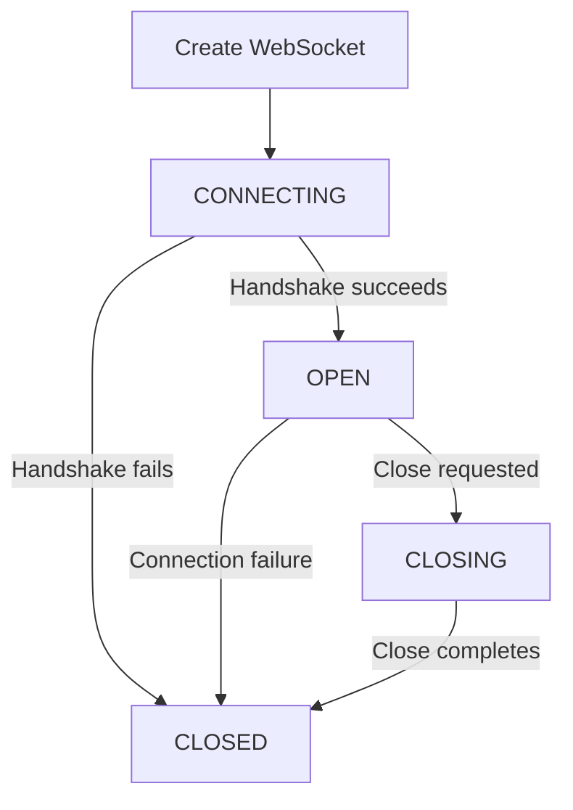
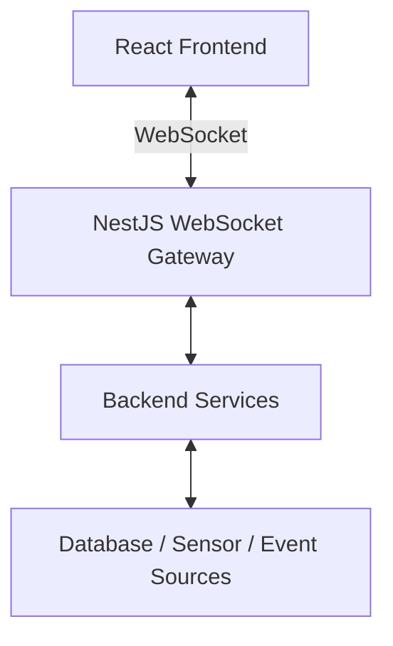

# WebSockets – Complete Guide for React Full Stack Developers

## Table of Contents

1. [What is WebSocket?](#1-what-is-websocket)
2. [Why Do We Need WebSockets?](#2-why-do-we-need-websockets)
3. [HTTP vs WebSocket](#3-http-vs-websocket)
4. [How WebSocket Works Internally](#4-how-websocket-works-internally)
5. [WebSocket URL](#5-websocket-url)
6. [WebSocket Client Integration](#6-websocket-client-integration)
7. [WebSocket Events](#7-websocket-events)
8. [WebSocket Connection Lifecycle](#8-websocket-connection-lifecycle)
9. [WebSocket ReadyState](#9-websocket-readystate)
10. [Sending and Receiving Messages](#10-sending-and-receiving-messages)
11. [WebSocket Integration in React](#11-websocket-integration-in-react)
12. [Why useEffect for WebSockets?](#12-why-useeffect-for-websockets)
13. [WebSocket Cleanup](#13-websocket-cleanup)
14. [useState vs useRef](#14-usestate-vs-useref)
15. [WebSocket Message Format](#15-websocket-message-format)
16. [Reconnection](#16-reconnection)
17. [Exponential Backoff](#17-exponential-backoff)
18. [Heartbeat – Ping and Pong](#18-heartbeat--ping-and-pong)
19. [WebSocket Authentication](#19-websocket-authentication)
20. [WebSocket vs Socket.IO](#20-websocket-vs-socketio)
21. [WebSocket Architecture with React and NestJS](#21-websocket-architecture-with-react-and-nestjs)
22. [NestJS WebSocket Gateway](#22-nestjs-websocket-gateway)
23. [React Integration with Socket.IO](#23-react-integration-with-socketio)
24. [WebSocket Rooms](#24-websocket-rooms)
25. [WebSocket Performance and Production Considerations](#25-websocket-performance-and-production-considerations)
26. [WebSocket Security](#26-websocket-security)
27. [Common Mistakes](#27-common-mistakes)
28. [Interview Questions](#28-interview-questions)
29. [Interview-Ready Answers](#29-interview-ready-answers)
30. [Quick Revision](#30-quick-revision)
31. [Learning Roadmap](#31-learning-roadmap)

---

# 1. What is WebSocket?

WebSocket is a communication protocol that allows the client and server to communicate with each other continuously over a single connection.

In traditional HTTP communication, the client sends a request and the server sends a response.

With WebSockets, once a connection is established, both the client and server can send messages to each other whenever required.

WebSockets are commonly used in applications that require real-time communication.

### Real-world examples

- Chat applications.
- Live notifications.
- Real-time dashboards.
- Sensor monitoring.
- Live stock market data.
- Multiplayer games.
- Live location tracking.
- Collaborative applications.
- Real-time order tracking.

### Simple definition

WebSocket is a protocol that provides bidirectional communication between a client and a server over a persistent connection.

---

# 2. Why Do We Need WebSockets?

Suppose we are building a React dashboard that displays sensor data.

The dashboard needs to display:

- Temperature.
- Pressure.
- Sensor status.
- Machine status.

The sensor generates new data continuously.

We want the frontend to receive updates immediately.

## Approach 1: HTTP Polling

The frontend repeatedly requests data from the backend.

```text
React Frontend
      |
      | GET /sensor-data
      |
      v
Backend
      |
      v
Database
      |
      v
Response
```

For example:

```text
Request
Response

Wait 5 seconds

Request
Response

Wait 5 seconds

Request
Response
```

This is called polling.

### Problems with polling

- Repeated HTTP requests.
- Unnecessary network traffic.
- Increased backend load.
- Data may be delayed.
- Many requests may return unchanged data.

## Approach 2: WebSocket

Instead of repeatedly requesting data, the frontend establishes a WebSocket connection once.

```text
React Frontend
       |
       | WebSocket Connection
       |
       v
Backend Server
       |
       | Connection Remains Open
       |
       v
Backend sends updates whenever needed
```

Once the connection is established:

- React can send messages to the backend.
- Backend can send messages to React.
- Data can be transmitted whenever required.
- The frontend doesn't need to repeatedly request the same data.

### Why WebSockets?

WebSockets are useful when the application needs real-time communication.

---

# 3. HTTP vs WebSocket

| Feature | HTTP | WebSocket |
|---|---|---|
| Communication | Request-response | Bidirectional |
| Connection | Request-response exchanges | Persistent connection |
| Client communication | Client sends requests | Client and server can send messages |
| Server push | Not directly in ordinary request-response HTTP | Supported |
| Real-time communication | Usually polling, SSE or other techniques | Native bidirectional communication |
| Protocol | HTTP/HTTPS | WS/WSS |
| Common usage | CRUD APIs | Chat, dashboards, live notifications |
| Connection management | HTTP request-response model | WebSocket lifecycle |

### HTTP

```text
Client ------ Request ------> Server

Client <----- Response ----- Server
```

### WebSocket

```text
Client <----------> Server
         Message

Client <----------> Server
         Message

Client <----------> Server
         Message
```

---

# 4. How WebSocket Works Internally

WebSocket communication begins with an HTTP handshake.

The client requests that the HTTP connection be upgraded to WebSocket.

## Step 1: Client initiates connection

```javascript
const socket = new WebSocket("ws://localhost:3000");
```

The browser sends an HTTP handshake request.

Conceptually:

```http
GET / HTTP/1.1
Host: localhost:3000
Upgrade: websocket
Connection: Upgrade
Sec-WebSocket-Key: random-key
Sec-WebSocket-Version: 13
```

## Step 2: Server accepts the handshake

If the server accepts the connection, it responds:

```http
HTTP/1.1 101 Switching Protocols
Upgrade: websocket
Connection: Upgrade
Sec-WebSocket-Accept: ...
```

## Step 3: Connection is established

The HTTP connection is upgraded to WebSocket.

```text
HTTP
 |
 | Handshake
 |
 v
WebSocket Connection
```

## Step 4: Messages are exchanged

```text
Client                Server

  |                      |
  |------ Message ------> |
  |                      |
  | <----- Message ------ |
  |                      |
  |------ Message ------> |
  |                      |
  | <----- Message ------ |
```

Both sides can communicate without establishing a new HTTP request for every message.

---

# 5. WebSocket URL

WebSockets use two common URL schemes.

| Protocol | Meaning |
|---|---|
| ws:// | WebSocket without TLS encryption |
| wss:// | WebSocket secured with TLS |

### Development

```javascript
const socket = new WebSocket("ws://localhost:3000");
```

### Production

```javascript
const socket = new WebSocket("wss://api.example.com/ws");
```

For production applications served over HTTPS, use WSS.

---

# 6. WebSocket Client Integration

The browser provides a native WebSocket API.

We don't need to install any external library for basic WebSocket functionality.

## Creating a WebSocket connection

```javascript
const socket = new WebSocket("ws://localhost:3000");
```

This creates a connection attempt.

The connection is not immediately ready, so we need to listen for events.

---

# 7. WebSocket Events

WebSocket provides four important events.

| Event | Purpose |
|---|---|
| open | Connection successfully established |
| message | Message received from server |
| error | Connection-related error |
| close | Connection closed |

## 7.1 Open Event

The `open` event fires when the connection is successfully established.

```javascript
socket.onopen = () => {
  console.log("WebSocket connection established");
};
```

## 7.2 Message Event

The `message` event fires when the server sends a message.

```javascript
socket.onmessage = (event) => {
  console.log("Received message:", event.data);
};
```

## 7.3 Error Event

The `error` event indicates that a connection-related error occurred.

```javascript
socket.onerror = (event) => {
  console.error("WebSocket error:", event);
};
```

## 7.4 Close Event

The `close` event fires when the connection closes.

```javascript
socket.onclose = (event) => {
  console.log("Connection closed");
  console.log("Code:", event.code);
  console.log("Reason:", event.reason);
  console.log("Clean:", event.wasClean);
};
```

---

# 8. WebSocket Connection Lifecycle

The WebSocket connection lifecycle describes the different states that a connection passes through from creation to closure.

The WebSocket API provides four states.

| State | Value | Meaning |
|---|---:|---|
| CONNECTING | 0 | Connection is being established |
| OPEN | 1 | Connection is open |
| CLOSING | 2 | Connection is closing |
| CLOSED | 3 | Connection is closed |

## Lifecycle Diagram



## Stage 1: CONNECTING

```javascript
const socket = new WebSocket("ws://localhost:3000");

console.log(socket.readyState);
```

The connection is being established.

We should not send normal messages before the connection is ready.

## Stage 2: OPEN

```javascript
socket.onopen = () => {
  console.log("Connected");
};
```

The connection is successfully established.

Now messages can be sent.

```javascript
socket.send("Hello Server");
```

## Stage 3: CLOSING

When we initiate the closing process:

```javascript
socket.close();
```

The connection enters the CLOSING state.

## Stage 4: CLOSED

When the connection is completely closed:

```javascript
socket.onclose = () => {
  console.log("Connection closed");
};
```

The state becomes CLOSED.

---

# 9. WebSocket readyState

`readyState` tells us the current state of the WebSocket connection.

```javascript
const socket = new WebSocket("ws://localhost:3000");

console.log(socket.readyState);
```

The values are:

```javascript
0 // CONNECTING
1 // OPEN
2 // CLOSING
3 // CLOSED
```

We can check the state before sending a message.

```javascript
if (socket.readyState === WebSocket.OPEN) {
  socket.send("Hello Server");
}
```

This ensures that the connection is open before sending data.

---

# 10. Sending and Receiving Messages

```javascript
const socket = new WebSocket("ws://localhost:3000");

socket.onopen = () => {
  console.log("Connected");

  socket.send("Hello from React");
};

socket.onmessage = (event) => {
  console.log("Server message:", event.data);
};

socket.onerror = (error) => {
  console.error("WebSocket error:", error);
};

socket.onclose = () => {
  console.log("Disconnected");
};
```

### Communication flow

1. Browser creates WebSocket.
2. Server accepts the connection.
3. `open` event fires.
4. Client sends a message.
5. Server receives the message.
6. Server sends a response.
7. `message` event fires on the client.
8. Connection remains open.
9. Eventually, the connection closes.

---

# 11. WebSocket Integration in React

## Basic React Example

```jsx
import { useEffect, useState } from "react";

function WebSocketComponent() {
  const [connectionStatus, setConnectionStatus] =
    useState("Disconnected");

  const [messages, setMessages] = useState([]);

  useEffect(() => {
    const socket = new WebSocket("ws://localhost:3000");

    socket.onopen = () => {
      setConnectionStatus("Connected");
    };

    socket.onmessage = (event) => {
      setMessages((previousMessages) => [
        ...previousMessages,
        event.data,
      ]);
    };

    socket.onerror = () => {
      setConnectionStatus("Error");
    };

    socket.onclose = () => {
      setConnectionStatus("Disconnected");
    };

    return () => {
      socket.close();
    };
  }, []);

  return (
    <div>
      <h2>WebSocket Demo</h2>

      <p>Status: {connectionStatus}</p>

      <h3>Messages</h3>

      {messages.map((message, index) => (
        <p key={index}>{message}</p>
      ))}
    </div>
  );
}

export default WebSocketComponent;
```

## How it works

### Step 1: State

```javascript
const [connectionStatus, setConnectionStatus] =
  useState("Disconnected");

const [messages, setMessages] = useState([]);
```

We track:

- Connection status.
- Messages received.

### Step 2: Establish connection

```javascript
useEffect(() => {
  const socket = new WebSocket("ws://localhost:3000");
}, []);
```

The Effect creates the connection.

### Step 3: Handle open

```javascript
socket.onopen = () => {
  setConnectionStatus("Connected");
};
```

### Step 4: Handle messages

```javascript
socket.onmessage = (event) => {
  setMessages((previousMessages) => [
    ...previousMessages,
    event.data,
  ]);
};
```

When a message arrives, we add it to the previous messages.

### Step 5: Handle errors

```javascript
socket.onerror = () => {
  setConnectionStatus("Error");
};
```

### Step 6: Handle closure

```javascript
socket.onclose = () => {
  setConnectionStatus("Disconnected");
};
```

### Step 7: Cleanup

```javascript
return () => {
  socket.close();
};
```

When the component no longer needs the connection, we close it.

---

# 12. Why useEffect for WebSockets?

WebSocket is an external system that React needs to synchronize with.

`useEffect` is suitable for managing the connection lifecycle.

```jsx
useEffect(() => {
  const socket = new WebSocket("ws://localhost:3000");

  socket.onopen = () => {
    console.log("Connected");
  };

  return () => {
    socket.close();
  };
}, []);
```

## Why not create a WebSocket in the component body?

Incorrect:

```jsx
function MyComponent() {
  const socket = new WebSocket("ws://localhost:3000");

  return <div>My Component</div>;
}
```

Every render can create another connection.

```text
Render 1 → WebSocket 1

Render 2 → WebSocket 2

Render 3 → WebSocket 3
```

This can lead to:

- Multiple unnecessary connections.
- Duplicate messages.
- Resource leaks.
- Unexpected behavior.

Instead, we manage the connection using an Effect.

---

# 13. WebSocket Cleanup

Cleanup is important because WebSocket connections consume resources.

## Without cleanup

```jsx
useEffect(() => {
  const socket = new WebSocket("ws://localhost:3000");

  socket.onmessage = (event) => {
    console.log(event.data);
  };
}, []);
```

We don't explicitly close the connection when the component unmounts.

## With cleanup

```jsx
useEffect(() => {
  const socket = new WebSocket("ws://localhost:3000");

  socket.onmessage = (event) => {
    console.log(event.data);
  };

  return () => {
    socket.close();
  };
}, []);
```

### Cleanup executes

- When the component unmounts.
- Before an Effect reruns when its dependencies change.
- During React Strict Mode's additional development setup-cleanup cycle.

---

# 14. useState vs useRef

We commonly use `useRef` to store a WebSocket instance.

```javascript
const socketRef = useRef(null);
```

The WebSocket instance doesn't need to trigger React renders whenever its reference changes.

| useState | useRef |
|---|---|
| Stores UI-related state | Stores mutable references |
| Updating causes render | Updating `.current` does not cause render |
| Connection status | WebSocket instance |
| Received messages | Socket reference |

Typical usage:

```javascript
const socketRef = useRef(null);

const [status, setStatus] = useState("Disconnected");
```

---

# 15. WebSocket Message Format

Real-world applications usually send structured JSON messages.

Example:

```json
{
  "type": "notification",
  "payload": {
    "message": "New sensor alert",
    "sensorId": "SENSOR-101"
  }
}
```

Another example:

```json
{
  "type": "sensor_update",
  "payload": {
    "sensorId": "SENSOR-101",
    "temperature": 35.5
  }
}
```

## Why use a type field?

A single WebSocket connection may carry multiple message types.

```text
WebSocket
   |
   |--- chat_message
   |
   |--- notification
   |
   |--- sensor_update
   |
   |--- status_update
```

The frontend can determine what to do based on the message type.

## Example

```javascript
socket.onmessage = (event) => {
  const data = JSON.parse(event.data);

  switch (data.type) {
    case "notification":
      console.log(data.payload);
      break;

    case "sensor_update":
      console.log(data.payload);
      break;

    case "chat_message":
      console.log(data.payload);
      break;

    default:
      console.log("Unknown message:", data);
  }
};
```

---

# 16. Reconnection

The native WebSocket API does not automatically reconnect after a connection closes.

We need to implement reconnection logic or use a library that supports it.

## Example

```javascript
let socket;
let reconnectTimeout;

function connect() {
  socket = new WebSocket("ws://localhost:3000");

  socket.onopen = () => {
    console.log("Connected");
  };

  socket.onmessage = (event) => {
    console.log(event.data);
  };

  socket.onclose = () => {
    console.log("Disconnected");

    reconnectTimeout = setTimeout(() => {
      connect();
    }, 3000);
  };

  socket.onerror = () => {
    socket.close();
  };
}

connect();
```

## How it works

```text
Connect
   |
   v
Connection Established
   |
   v
Connection Closed
   |
   v
Wait 3 Seconds
   |
   v
Reconnect
```

This is a simple demonstration. Production reconnection logic should also handle cleanup, retry limits, connection state, network changes and intentional disconnections.

---

# 17. Exponential Backoff

Exponential backoff increases the delay between repeated connection attempts.

Instead of reconnecting every 3 seconds, we gradually increase the delay.

| Attempt | Delay |
|---|---:|
| 1 | 1 second |
| 2 | 2 seconds |
| 3 | 4 seconds |
| 4 | 8 seconds |
| 5 | 16 seconds |
| 6 | 30 seconds |

Formula:

Delay = min(Initial Delay × 2^n, Maximum Delay)

Example:

```javascript
let retryCount = 0;

const MAX_RETRY_DELAY = 30000;

function getRetryDelay() {
  const delay = Math.min(
    1000 * 2 ** retryCount,
    MAX_RETRY_DELAY
  );

  retryCount++;

  return delay;
}
```

### Why use exponential backoff?

- Reduces server load.
- Prevents aggressive reconnection.
- Helps recover from temporary outages.
- Reduces reconnection storms.

In production, random jitter is often added.

---

# 18. Heartbeat – Ping and Pong

## What is a heartbeat?

A heartbeat is a periodic mechanism used to check whether a connection or peer is still responsive.

Sometimes the network connection silently fails.

The client may still believe it is connected.

```text
Client <----------> Server

Connection appears open
But communication is broken
```

## Heartbeat concept

```text
Client -------- Ping --------> Server

Client <------- Pong --------- Server
```

If the response isn't received within the expected time, the connection may be considered unhealthy.

### Browser limitation

The browser's native WebSocket API does not expose protocol-level ping and pong methods to JavaScript.

Protocol-level ping/pong frames are typically handled by the server and WebSocket implementation.

Browser applications can implement an application-level heartbeat using ordinary WebSocket messages.

Example:

```json
{
  "type": "ping"
}
```

Response:

```json
{
  "type": "pong"
}
```

These are application messages, not WebSocket protocol control frames.

---

# 19. WebSocket Authentication

WebSockets also need authentication.

```text
User Login
    |
    v
Authentication
    |
    v
Token or Session
    |
    v
WebSocket Connection
    |
    v
Authenticated Communication
```

## Can browser WebSocket send custom Authorization headers?

The native browser WebSocket constructor does not allow arbitrary custom HTTP headers.

```javascript
new WebSocket("wss://example.com", protocols);
```

It accepts a URL and optional subprotocols, not arbitrary custom headers.

### Common approaches

- Cookie-based authentication.
- Authentication through application messages.
- Carefully designed token-based approaches.

### Message-based authentication example

```javascript
socket.onopen = () => {
  socket.send(
    JSON.stringify({
      type: "authenticate",
      token: accessToken,
    })
  );
};
```

The backend validates the token and determines whether the connection is authorized.

### Security considerations

- Validate the token.
- Validate user permissions.
- Validate the Origin.
- Never trust the client.
- Protect sensitive data.
- Use WSS in production.

---

# 20. WebSocket vs Socket.IO

WebSocket is a protocol.

Socket.IO is a library that provides event-based communication and additional functionality.

| WebSocket | Socket.IO |
|---|---|
| Communication protocol | Communication library |
| Native browser API | Requires client library |
| No automatic reconnection in native API | Reconnection support |
| Message-based | Event-based abstraction |
| No built-in rooms | Rooms and namespaces |
| No built-in fallback | Fallback transport mechanisms |
| Minimal functionality | Additional abstractions |

## Native WebSocket

```javascript
const socket = new WebSocket("wss://example.com");

socket.onopen = () => {
  socket.send("Hello");
};

socket.onmessage = (event) => {
  console.log(event.data);
};
```

## Socket.IO

```javascript
import { io } from "socket.io-client";

const socket = io("https://example.com");

socket.on("connect", () => {
  console.log("Connected");
});

socket.on("notification", (data) => {
  console.log(data);
});
```

### Important

Socket.IO is not directly compatible with a plain WebSocket server.

Socket.IO uses its own protocol on top of transports, including WebSocket.

---

# 21. WebSocket Architecture with React and NestJS

Consider a real-time sensor dashboard.

Technologies:

- React – Frontend.
- NestJS – Backend.
- PostgreSQL – Database.
- WebSocket – Real-time communication.



## Flow

### Step 1: React connects

React establishes a WebSocket connection.

### Step 2: Backend accepts the connection

NestJS accepts the connection after appropriate authentication and validation.

### Step 3: Sensor data is generated

```json
{
  "sensorId": "SENSOR-101",
  "temperature": 35.5,
  "status": "ACTIVE"
}
```

### Step 4: Backend processes data

The backend:

- Receives or retrieves data.
- Processes it.
- Applies business rules.
- Determines which clients should receive updates.

### Step 5: Backend sends message

```json
{
  "type": "sensor_update",
  "payload": {
    "sensorId": "SENSOR-101",
    "temperature": 35.5,
    "status": "ACTIVE"
  }
}
```

### Step 6: React receives update

React receives the message and updates its state.

### Step 7: UI updates

The dashboard updates without refreshing the page.

---

# 22. NestJS WebSocket Gateway

NestJS supports WebSockets through gateways.

This example uses Socket.IO.

## Step 1: Install dependencies

```bash
npm install @nestjs/websockets @nestjs/platform-socket.io socket.io
```

## Step 2: Create Gateway

### events.gateway.ts

```typescript
import {
  WebSocketGateway,
  WebSocketServer,
  SubscribeMessage,
  MessageBody,
  OnGatewayInit,
  OnGatewayConnection,
  OnGatewayDisconnect,
} from "@nestjs/websockets";

import { Server, Socket } from "socket.io";

@WebSocketGateway({
  cors: {
    origin: "http://localhost:5173",
  },
})
export class EventsGateway
  implements OnGatewayInit, OnGatewayConnection, OnGatewayDisconnect
{
  @WebSocketServer()
  server: Server;

  afterInit(server: Server) {
    console.log("WebSocket Gateway initialized");
  }

  handleConnection(client: Socket) {
    console.log("Client connected:", client.id);
  }

  handleDisconnect(client: Socket) {
    console.log("Client disconnected:", client.id);
  }

  @SubscribeMessage("message")
  handleMessage(
    @MessageBody() data: string,
    client: Socket,
  ) {
    console.log("Received message:", data);

    client.emit("message_response", {
      message: "Message received",
    });
  }

  sendNotification(data: any) {
    this.server.emit("notification", data);
  }
}
```

## Understanding decorators

### @WebSocketGateway()

Marks a class as a WebSocket gateway.

### @WebSocketServer()

Injects the underlying server instance.

### @SubscribeMessage()

Defines a handler for a particular event.

### @MessageBody()

Extracts the message payload.

### handleConnection()

Handles a new client connection.

### handleDisconnect()

Handles client disconnection.

### afterInit()

Runs after gateway initialization.

This example uses Socket.IO rather than the native WebSocket protocol implementation.

---

# 23. React Integration with Socket.IO

## Step 1: Install

```bash
npm install socket.io-client
```

## Step 2: React component

```jsx
import { useEffect, useState } from "react";
import { io } from "socket.io-client";

function SensorDashboard() {
  const [sensorData, setSensorData] = useState(null);
  const [status, setStatus] = useState("Disconnected");

  useEffect(() => {
    const socket = io("http://localhost:3000", {
      reconnection: true,
      reconnectionAttempts: 10,
      reconnectionDelay: 1000,
    });

    socket.on("connect", () => {
      setStatus("Connected");
    });

    socket.on("disconnect", () => {
      setStatus("Disconnected");
    });

    socket.on("connect_error", () => {
      setStatus("Connection Error");
    });

    socket.on("sensor_update", (data) => {
      setSensorData(data);
    });

    return () => {
      socket.disconnect();
    };
  }, []);

  return (
    <div>
      <h2>Sensor Dashboard</h2>

      <p>Connection: {status}</p>

      {sensorData && (
        <div>
          <p>Sensor: {sensorData.sensorId}</p>
          <p>Temperature: {sensorData.temperature}</p>
          <p>Status: {sensorData.status}</p>
        </div>
      )}
    </div>
  );
}

export default SensorDashboard;
```

### Important methods

| Code | Purpose |
|---|---|
| io() | Creates connection |
| connect | Handles connection |
| disconnect | Handles disconnection |
| connect_error | Handles connection errors |
| sensor_update | Handles sensor data |
| disconnect() | Cleanup |

---

# 24. WebSocket Rooms

Rooms are used in Socket.IO to group connected clients.

Suppose we have multiple dashboards.

```text
Room: SENSOR-101
    User A
    User B

Room: SENSOR-102
    User C
    User D
```

## Joining a room

```typescript
@SubscribeMessage("join_sensor")
handleJoinSensor(
  @MessageBody() sensorId: string,
  client: Socket,
) {
  client.join(sensorId);
}
```

## Sending to a room

```typescript
this.server
  .to("SENSOR-101")
  .emit("sensor_update", {
    sensorId: "SENSOR-101",
    temperature: 35.5,
  });
```

Only clients in the specified room receive the message.

### Security

The backend must verify that the user is authorized to join the room.

---

# 25. WebSocket Performance and Production Considerations

## 1. Avoid sending unnecessary data

Send only relevant information to the client.

## 2. Handle connection cleanup

Close unnecessary connections.

## 3. Implement reconnection

Network interruptions are normal.

## 4. Handle authentication

Protect WebSocket connections and messages.

## 5. Validate messages

Validate:

- Message type.
- Payload.
- User identity.
- Permissions.
- Message size.

## 6. Handle message ordering

Design message processing for operations where ordering matters.

## 7. Handle duplicate messages

Use message IDs or idempotency strategies for important operations.

## 8. Manage backpressure

A client may not process messages as quickly as the server sends them.

Consider:

- Rate limiting.
- Batching.
- Buffering.
- Dropping obsolete updates.
- Message prioritization.

## 9. Scaling WebSockets

```text
             Load Balancer
                  |
        ----------------------
        |         |         |
        v         v         v
     Server 1  Server 2  Server 3
```

Clients may connect to different server instances.

For Socket.IO, a shared adapter such as Redis can distribute events across instances.

A WebSocket connection is generally associated with the server instance that accepted it. Cross-instance communication requires additional infrastructure.

---

# 26. WebSocket Security

Important security considerations:

- Use WSS in production.
- Validate the Origin.
- Authenticate connections.
- Authorize every protected action.
- Validate incoming messages.
- Apply message size limits.
- Avoid exposing sensitive data.
- Rate-limit connections and messages.
- Protect against connection exhaustion.
- Use secure cookie configuration where applicable.
- Handle session expiration.
- Don't blindly trust room IDs supplied by clients.

---

# 27. Common Mistakes

## 1. Creating WebSockets during component rendering

Creates unnecessary connections.

## 2. Not cleaning up connections

Can cause unnecessary resources and duplicate behavior.

## 3. Sending messages while CONNECTING

Messages should be sent only when the connection is ready.

## 4. Not implementing reconnection

Network failures are normal.

## 5. Not handling errors

Connection failures should be handled.

## 6. Not understanding Socket.IO vs WebSocket

They are different protocols/implementations and clients are not directly interchangeable.

## 7. Not validating incoming data

WebSocket messages must be treated as untrusted input.

## 8. Not handling authentication

WebSockets need authentication and authorization.

## 9. Sending every update to every client

Use appropriate filtering, subscriptions or rooms.

## 10. Not considering scalability

Multiple backend instances may require shared event distribution.

---

# 28. Interview Questions

## Fundamentals

1. What is WebSocket?
2. Why do we need WebSockets?
3. How does WebSocket work internally?
4. What is the difference between HTTP and WebSocket?
5. What is the difference between WebSocket and Socket.IO?
6. What is the WebSocket handshake?
7. What does HTTP 101 mean?
8. What is the difference between ws and wss?

## React Integration

9. How do you integrate WebSockets in React?
10. Why do we use useEffect for WebSocket connections?
11. Why do we use useRef?
12. How do you receive messages?
13. How do you send messages?
14. Why is cleanup necessary?
15. What happens if WebSocket is created in the component body?
16. How do you update React state?

## Lifecycle

17. What is the WebSocket lifecycle?
18. What is readyState?
19. What are the four WebSocket states?
20. What is the open event?
21. What is the message event?
22. What is the error event?
23. What is the close event?
24. What is the difference between CLOSING and CLOSED?

## Advanced

25. How do you reconnect?
26. What is exponential backoff?
27. What is a heartbeat?
28. What are ping and pong?
29. How do you authenticate WebSockets?
30. What are WebSocket rooms?
31. How do you handle multiple clients?
32. How do you scale WebSockets?
33. How do you handle security?
34. What is backpressure?
35. How do you prevent duplicate connections?
36. How do you handle stale connections?

---

# 29. Interview-Ready Answers

## Q1. What is WebSocket?

WebSocket is a communication protocol that enables bidirectional communication between a client and a server over a persistent connection.

It is useful for real-time applications such as chat, notifications, dashboards and live monitoring.

## Q2. How do you integrate WebSockets in React?

In React, I integrate WebSockets by creating a connection inside a useEffect. I store the WebSocket instance in a useRef because it doesn't need to trigger React renders.

I handle the open, message, error and close events. When messages arrive, I update React state so the UI reflects the latest data.

I also close the connection during cleanup when the component no longer needs it. For production applications, I consider reconnection, authentication, message validation and error handling.

For larger applications, I prefer encapsulating the connection logic inside a custom hook or service.

## Q3. Explain WebSocket connection lifecycle.

The WebSocket lifecycle consists of CONNECTING, OPEN, CLOSING and CLOSED.

When we create a WebSocket instance, it enters CONNECTING while the handshake is being established.

When the handshake succeeds, it enters OPEN, and both client and server can exchange messages.

When the connection is being terminated, it enters CLOSING.

Once the connection is completely terminated, it enters CLOSED.

In React, I manage the connection through an Effect and handle the relevant events. I also implement cleanup, and for production systems, reconnection and authentication.

## Q4. Why do we use useRef?

I use useRef to store the WebSocket instance because I need to retain the connection between renders without causing unnecessary renders whenever the reference changes.

I use state for UI-related information such as connection status and received messages.

## Q5. Why do we use useEffect?

A WebSocket is an external system. useEffect allows React to synchronize the component with that system by establishing a connection, registering event handlers and cleaning up the connection.

## Q6. What is the difference between WebSocket and Socket.IO?

WebSocket is a communication protocol, while Socket.IO is a library that provides event-based communication and additional features such as reconnection and rooms.

Socket.IO is not directly compatible with a plain WebSocket server because it uses its own protocol.

## Q7. What is exponential backoff?

Exponential backoff is a reconnection strategy that progressively increases the delay between failed connection attempts.

It helps reduce server load and prevents clients from repeatedly reconnecting at the same interval.

## Q8. What is a heartbeat?

A heartbeat is a periodic mechanism used to determine whether a connection or peer is still responsive.

It helps detect stale or unhealthy connections.

## Q9. How do you handle WebSocket security?

I use WSS, validate the Origin, authenticate the connection, validate messages, enforce authorization, apply rate limits and avoid exposing sensitive data.

## Q10. How do you scale WebSockets?

In a multi-server architecture, clients may connect to different server instances.

We need a shared communication mechanism to distribute events across instances.

For Socket.IO, a Redis-based adapter can be used to distribute events across servers. The architecture also needs to consider load balancing, connection management and authentication.

---

# 30. Quick Revision

| Concept | Meaning |
|---|---|
| WebSocket | Bidirectional communication protocol |
| HTTP | Request-response communication |
| WS | Unencrypted WebSocket |
| WSS | Encrypted WebSocket |
| CONNECTING | Connection being established |
| OPEN | Connection established |
| CLOSING | Connection is closing |
| CLOSED | Connection closed |
| open | Connection successfully opened |
| message | Message received |
| error | Connection-related error |
| close | Connection closed |
| readyState | Current connection state |
| useEffect | Connection setup and cleanup |
| useRef | Store WebSocket instance |
| cleanup | Close connection when no longer needed |
| reconnection | Re-establish connection after interruption |
| exponential backoff | Increase retry delays |
| heartbeat | Check connection responsiveness |
| Socket.IO | Event-based communication library |
| room | Group of Socket.IO clients |
| Gateway | NestJS WebSocket handler |
| backpressure | Handling data faster than client can process |

---

# 31. Learning Roadmap

## Phase 1 – Fundamentals

- What is WebSocket?
- HTTP vs WebSocket.
- WebSocket handshake.
- WS vs WSS.
- WebSocket lifecycle.
- WebSocket events.

## Phase 2 – React

- WebSocket client integration.
- useEffect.
- useRef.
- Sending messages.
- Receiving messages.
- React state updates.
- Cleanup.
- Custom hooks.

## Phase 3 – Reliability

- Error handling.
- Reconnection.
- Exponential backoff.
- Heartbeat.
- Stale connections.

## Phase 4 – Full Stack

- NestJS WebSocket Gateway.
- Socket.IO.
- Rooms.
- Authentication.
- Broadcasting.
- Backend event handling.

## Phase 5 – System Design

- Scaling WebSockets.
- Load balancers.
- Redis Pub/Sub.
- Multiple WebSocket servers.
- Message ordering.
- Backpressure.
- WebSocket security.

---

## Final Goal

Understand how WebSockets enable real-time communication, how React manages a WebSocket connection, how the connection lifecycle works, how NestJS handles WebSocket events, and how to make a real-time application reliable and scalable.
